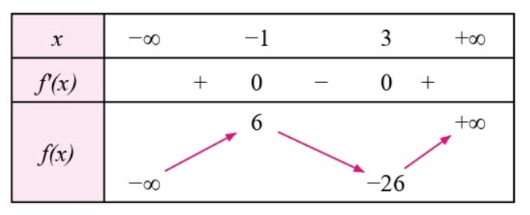
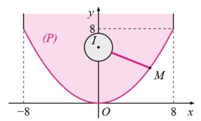
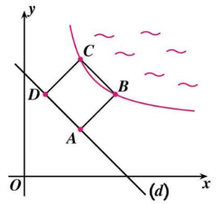
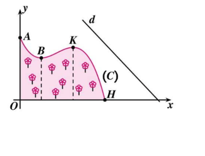
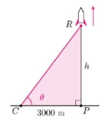
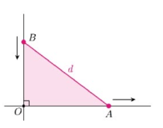
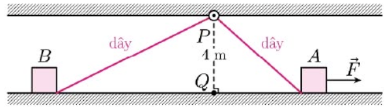

# Bài tập luyện thêm

---

**Câu 1.** Cho hàm số bậc ba $f(x) = ax^3 + bx^2 + cx + d$ có bảng biến thiên như sau:

Xét tính đúng sai của các mệnh đề sau:  
a) Hàm số đã cho nghịch biến trên khoảng $(-1; 3)$.  
b) $a + b + c + d = -10$.  
c) Giá trị lớn nhất của hàm số đã cho trên đoạn $[0; 6]$ bằng $6$.  
d) Có đúng hai số nguyên $x$ thỏa mãn $x < 3$ và $f(x) > 0$.

---

**Câu 2.** Trong một công viên có một hồ nước và một chòi nghỉ hình tròn nằm giữa hồ. Chọn hệ trục tọa độ $Oxy$ (đơn vị trên mỗi trục là mét) sao cho bờ hồ là phần parabol $(P): y = \dfrac{x^2}{8}$ với $-8 \le x \le 8$, mặt nước nằm phía trên $(P)$, chòi nghỉ có tâm $I(0; 6)$ và bán kính $1,5\text{ m}$. Người ta muốn bắc một cây cầu thẳng từ một điểm $M$ trên bờ hồ đến chòi nghỉ sao cho cầu ngắn nhất (xem hình bên).

Xét tính đúng sai của các mệnh đề sau:  
a) Điểm có tọa độ $(8; 8)$ nằm trên bờ hồ.  
b) Nếu $M$ có hoành độ $x$ thì $IM^2 = x^2 + \left(\dfrac{x^2}{8} - 6\right)^2$.  
c) Khoảng cách từ $I$ đến bờ hồ (khoảng cách ngắn nhất từ $I$ đến một điểm của $(P)$) bằng $4\sqrt{2}\text{ m}$.  
d) Có đúng một vị trí của $M$ trên bờ hồ để cây cầu ngắn nhất.

---

**Câu 3.** Một nhà máy sản xuất X hoạt động tại khu vực gần một dòng suối lớn. Trong quá trình sản xuất, nhà máy thải ra một lượng chất ô nhiễm đáng kể vào môi trường, gây ảnh hưởng nghiêm trọng đến chất lượng nước và sức khoẻ cộng đồng. Để cải thiện tình hình và tuân thủ các quy định về bảo vệ môi trường, nhà máy đã quyết định đầu tư vào một hệ thống xử lý nước thải hiện đại. Chi phí để loại bỏ $x\%$ chất ô nhiễm từ nguồn nước thải được mô hình hoá bởi hàm số:
$$C(x) = \dfrac{2x+1}{1-0,01x}\text{ (triệu đồng)},\quad 0 \le x < 100$$
Xét tính đúng sai của các mệnh đề sau:  
a) Chi phí để loại bỏ $20\%$ chất ô nhiễm là $51,52$ triệu đồng.  
b) Nhà máy không thể loại bỏ $100\%$ chất ô nhiễm.  
c) Để chi phí không quá $200$ triệu đồng thì nhà máy chỉ có thể xử lý tối đa $49,75\%$ chất ô nhiễm.  
d) Nếu nhà máy giảm từ $20\%$ chất ô nhiễm trở lên thì doanh thu sẽ tăng lên (nhờ vào việc nâng cao uy tín và hình ảnh thương hiệu) được biểu diễn bởi hàm số $R(x) = 12x - 240$ (triệu đồng). Khi đó lợi nhuận cho việc loại bỏ chất ô nhiễm có thể đạt hơn $177$ triệu đồng.

---

**Câu 4.** Một nhà máy chế biến cà phê bán trong nước và xuất khẩu ra nước ngoài cho biết, nếu giá vốn sản xuất mỗi kg cà phê là $x$ USD thì sản lượng nhà máy sản xuất được là $R(x) = x - 150\text{ (kg)}$ và lượng tiêu thụ trong nước là $Q(x) = 2700 - x\text{ (kg)}$. Phần cà phê còn dư được xuất khẩu với giá cố định là $1900\text{ USD}$ mỗi kg. Biết rằng với mỗi kg cà phê xuất khẩu thì nhà máy phải chịu mức thuế là $m\text{ USD}$. Lợi nhuận từ xuất khẩu và thuế thu được từ nhà nước luôn giữ tỷ lệ bằng $4 : 1$. Hãy tìm giá trị của $m$ để lợi nhuận từ xuất khẩu đạt giá trị lớn nhất.

---

**Câu 5.** Một công ty khai thác tuyến tàu cao tốc chở khách du lịch từ đất liền ra đảo với khoảng cách $80\text{ km}$. Giả sử tàu di chuyển với vận tốc $v$ không đổi trên suốt tuyến đường. Chi phí vận hành cho mỗi giờ hoạt động của tàu bao gồm:
* Chi phí nhiên liệu: $125v^3$ (đồng), với $v\text{ (km/h)}$ là vận tốc của tàu ($v > 0$).
* Chi phí cố định (lương thủy thủ đoàn, khấu hao, bến bãi, ...): $12\,000\,000$ đồng.

Để đảm bảo lịch trình và trải nghiệm của hành khách, thời gian di chuyển mỗi chuyến không được vượt quá 2 giờ. Đồng thời, vì lý do an toàn hàng hải, tàu không được chạy quá $60\text{ km/h}$. Tàu có sức chứa tối đa 200 hành khách và giả sử rằng số lượng khách trên mỗi chuyến đi luôn đạt mức tối đa. Ban giám đốc thiết lập mục tiêu lợi nhuận thu được từ mỗi chuyến đi bằng $25\%$ tổng chi phí vận hành của chuyến đó. Để đạt được mức lợi nhuận này trong điều kiện tàu được vận hành với tổng chi phí thấp nhất, giá vé mỗi hành khách phải trả là bao nhiêu nghìn đồng?

---

**Câu 6.** Trong một công viên có một hồ nước và một đường đi lát gạch hoa. Thiết lập hệ trục $Oxy$ như hình vẽ dưới, kiến trúc sư thấy rằng bờ hồ có thể coi như một nhánh của đồ thị hàm số $y = \dfrac{2x+1}{x-1}$ và đường đi khi đó ứng với đường thẳng $(d): y = -x + 4$. Để đảm bảo ánh sáng, kiến trúc sư muốn đặt 2 cột đèn trên bờ hồ và 2 cột đèn trên đường đi sao cho 4 cột đèn này tạo thành một hình vuông. Tính khoảng cách giữa hai cột đèn trên bờ hồ *(làm tròn đến hàng phần trăm)*.

---

**Câu 7.** Một khu vực trồng hoa được xây dựng trong khu du lịch sinh thái. Trong mô hình minh hoạ (như hình vẽ), nó được giới hạn bởi các trục toạ độ và đồ thị $(C)$ của một hàm số bậc ba. Biết rằng đồ thị $(C)$ đi qua các điểm $A(0; 8), B(2; 5,4), K(5; 6,75)$ và $H(8; 0)$. Trong khu du lịch sinh thái có một con đường chạy dọc theo đường thẳng $d: y = -\dfrac{13}{9}x + \dfrac{169}{9}$. Tìm hoành độ của điểm $M$ thuộc $(C)$ sao cho khoảng cách từ $M$ đến $d$ là nhỏ nhất *(làm tròn kết quả đến hàng phần trăm)*.

---

**Câu 8.** Một camera được đặt trên mặt đất, cách bệ phóng tên lửa $3000\text{ m}$. Tên lửa được phóng thẳng đứng lên trên với tốc độ $200\text{ m/s}$. Để giữ tên lửa luôn ở trung tâm khung hình, camera phải liên tục quay ngẩng lên. Hỏi góc ngẩng của camera đang thay đổi với tốc độ bao nhiêu (tính bằng rad/s) tại thời điểm tên lửa đạt độ cao $4000\text{ m}$?

---

**Câu 9.** Hai con đường thẳng vuông góc cắt nhau tại $O$. Cùng một thời điểm, xe $A$ xuất phát từ $O$, chạy trên đường thứ nhất với tốc độ $40\text{ km/h}$; xe $B$ đang cách $O$ một khoảng $30\text{ km}$ trên đường thứ hai, chạy về phía $O$ với tốc độ $30\text{ km/h}$. Hai xe chuyển động thẳng đều. Tại thời điểm lần thứ hai khoảng cách giữa hai xe bằng $25\text{ km}$, khoảng cách ấy đang tăng hay giảm, với tốc độ bao nhiêu?

---

**Câu 10.** Hai thùng hàng $A$ và $B$ đặt trên mặt sàn nhà kho được nối với nhau bằng một sợi dây dài $15\text{ m}$. Sợi dây vắt qua một ròng rọc cố định tại điểm $P$ trên trần nhà. Khoảng cách từ ròng rọc $P$ thẳng đứng xuống điểm $Q$ trên mặt sàn là $PQ = 4\text{ m}$. Bỏ qua ma sát; trong suốt quá trình di chuyển, sợi dây luôn căng và hai thùng hàng chỉ trượt trên mặt sàn. Tại thời điểm thùng $A$ cách $Q$ một khoảng $3\text{ m}$ và đang bị kéo trượt ra xa $Q$ với tốc độ $0,5\text{ m/s}$, thùng $B$ đang tiến lại gần $Q$ với tốc độ bao nhiêu? *(Làm tròn kết quả đến hàng phần trăm.)*

