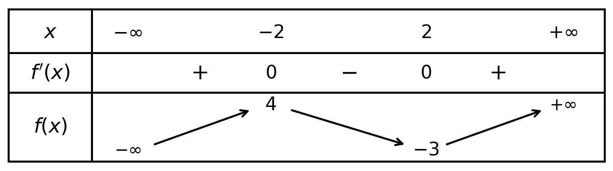
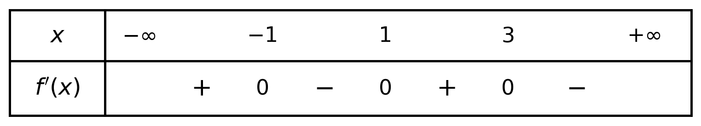
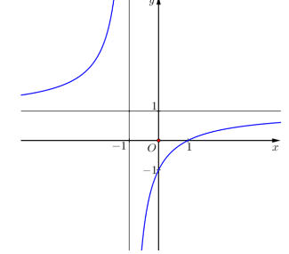
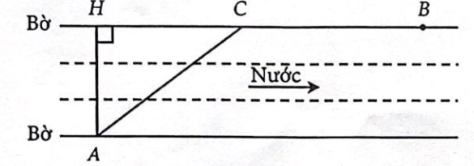
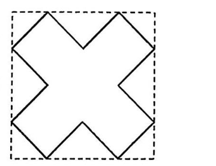

# SỞ GD&ĐT QUẢNG TRỊ - TRƯỜNG THPT QUẢNG TRỊ
### KỲ KHẢO SÁT CHẤT LƯỢNG LỚP 12 NĂM HỌC 2026 - 2027
**Môn: TOÁN - Lớp 12 (ĐỀ THI THỬ GIỮA KÌ 1)**  
*Thời gian làm bài: 90 phút (không kể thời gian giao đề)*  
*Biên soạn: Trần Trung Quân*  
**Mã đề thi: 105**  
*(Đề thi gồm có 04 trang)*

---

Họ và tên học sinh: ............................................................................  
Lớp: ............................................................................

---

## PHẦN I. Thí sinh trả lời từ câu 1 đến câu 12. Mỗi câu hỏi thí sinh chỉ chọn một phương án.
*(Mỗi câu trả lời đúng thí sinh được 0,25 điểm)*

**Câu 1.** Cho hàm số $y = f(x)$ có bảng biến thiên như sau:

  

Hàm số đã cho đồng biến trên khoảng nào dưới đây?  
A. $(-2; 2)$.  
B. $(-\infty; -2)$.  
C. $(-3; 4)$.  
D. $(-2; +\infty)$.

**Câu 2.** Cho hàm số $y = f(x)$ có bảng xét dấu của đạo hàm $f'(x)$ như sau:

  

Số điểm cực tiểu của hàm số đã cho là  
A. $0$.  
B. $2$.  
C. $1$.  
D. $3$.

**Câu 3.** Giá trị nhỏ nhất của hàm số $f(x) = x^3 - 3x + 5$ trên đoạn $[0; 2]$ bằng  
A. $3$.  
B. $5$.  
C. $7$.  
D. $1$.

**Câu 4.** Đường tiệm cận đứng của đồ thị hàm số $y = \dfrac{2x + 1}{x - 3}$ là  
A. $y = 2$.  
B. $x = -3$.  
C. $x = 3$.  
D. $y = 3$.

**Câu 5.** Đường tiệm cận xiên của đồ thị hàm số $y = \dfrac{x^2 - 3x + 5}{x - 1}$ là đường thẳng  
A. $y = x + 2$.  
B. $y = x - 2$.  
C. $y = x - 3$.  
D. $y = -x + 2$.

**Câu 6.** Tọa độ tâm đối xứng của đồ thị hàm số $y = \dfrac{3x - 2}{x + 1}$ là điểm  
A. $I(1; 3)$.  
B. $I(-1; -2)$.  
C. $I(3; -1)$.  
D. $I(-1; 3)$.

**Câu 7.** Hàm số $y = \sqrt{4 - x^2}$ nghịch biến trên khoảng nào dưới đây?  
A. $(0; 2)$.  
B. $(-2; 0)$.  
C. $(-2; 2)$.  
D. $(-\infty; 0)$.

**Câu 8.** Có bao nhiêu giá trị nguyên của tham số $m \in [-5; 5]$ để hàm số $y = \dfrac{x - 3}{x - m}$ đồng biến trên khoảng $(0; +\infty)$?  
A. $6$.  
B. $5$.  
C. $7$.  
D. $4$.

**Câu 9.** Gọi $m$ là giá trị nhỏ nhất của hàm số $f(x) = (x^2 - 2)e^{2x}$ trên đoạn $[-1; 2]$. Khi đó $m$ có dạng $m = a + be^2\ (a, b \in \mathbb{Z})$. Tính $2a + b$.  
A. $2$.  
B. $1$.  
C. $-1$.  
D. $-2$.

**Câu 10.** Cho hàm số $y = f(x)$ có đồ thị như hình vẽ bên dưới:

  

Biểu thức $f(x)$ là biểu thức nào sau đây?  
A. $-x^3 + 3x - 1$.  
B. $\dfrac{2x - 1}{x + 1}$.  
C. $x + \dfrac{1}{x}$.  
D. $\dfrac{x - 1}{x + 1}$.

**Câu 11.** Cho hàm số $y = f(x)$ liên tục trên tập số thực, có bảng biến thiên như hình vẽ sau:

| $x$ | $-\infty$ | | $-1$ | | $0$ | | $1$ | | $+\infty$ |
| :---: | :---: | :---: | :---: | :---: | :---: | :---: | :---: | :---: | :---: |
| $y'$ | | $-$ | $0$ | $+$ | $0$ | $-$ | $0$ | $+$ | |
| $y$ | $+\infty$ | | | | $3$ | | | | $+\infty$ |
| | | $\searrow$ | $-2$ | $\nearrow$ | | $\searrow$ | $-2$ | $\nearrow$ | |

Điểm cực đại của hàm số là  
A. $y = 3$.  
B. $M(0; 3)$.  
C. $N(1; -2)$.  
D. $x = 0$.

**Câu 12.** Hàm số $f(x)$ có đạo hàm $f'(x) = x^2(x - 1)(x - 2)^3, \forall x \in \mathbb{R}$. Hàm số $f(x)$ có bao nhiêu điểm cực đại?  
A. $3$.  
B. $1$.  
C. $0$.  
D. $2$.

---

## PHẦN II. Thí sinh trả lời từ câu 1 đến câu 4. Trong mỗi ý a), b), c), d) ở mỗi câu, thí sinh chọn đúng hoặc sai.
*(Điểm: đúng 1 ý được 0,1 điểm; đúng 2 ý được 0,25 điểm; đúng 3 ý được 0,5 điểm; đúng 4 ý được 1,0 điểm)*

**Câu 1.** Cho hàm số bậc ba $y = f(x)$ có bảng biến thiên như sau:

| $x$ | $-\infty$ | | $-1$ | | $1$ | | $+\infty$ |
| :---: | :---: | :---: | :---: | :---: | :---: | :---: | :---: |
| $f'(x)$ | | $+$ | $0$ | $-$ | $0$ | $+$ | |
| $f(x)$ | | $\nearrow$ | $3$ | | | $\nearrow$ | $+\infty$ |
| | $-\infty$ | | | $\searrow$ | $-5$ | | |

a) Hàm số $y = f(x)$ đạt cực đại tại điểm $x = 1$.  
b) Hàm số $y = f(x)$ đồng biến trên khoảng $(-5; +\infty)$.  
c) Đồ thị hàm số $y = f(x)$ đi qua điểm có tọa độ $(0; -1)$.  
d) $f(-1) = f(2)$.

**Câu 2.** Cho hàm số $y = \dfrac{-x^2 - 3x + 4}{x - 3}$ có đồ thị là $(C)$.  
a) Đồ thị $(C)$ có tiệm cận xiên là $y = -x - 6$.  
b) Đồ thị $(C)$ nhận giao điểm $I(3; -9)$ làm tâm đối xứng.  
c) Đồ thị $(C)$ có hai điểm cực trị nằm về hai phía đối với trục tung $Oy$.  
d) Đồ thị $(C)$ không cắt trục hoành $Ox$.

**Câu 3.** Số dân của một thị trấn sau $t$ năm ($t \ge 0$) kể từ năm 1970 được ước tính bởi công thức:
$$f(t) = \dfrac{26t + 10}{t + 5}\quad (f(t)\text{ được tính bằng nghìn người})$$
a) Số dân của thị trấn giảm trong những năm từ 1975 đến 1980.  
b) Đạo hàm của hàm số $f$ biểu thị tốc độ tăng dân số của thị trấn (tính bằng nghìn người/năm). Vào năm 1998 thì tốc độ tăng dân số là $0{,}125\text{ nghìn người/năm}$.  
c) Đạo hàm $f'(t) = \dfrac{120}{(t + 5)^2},\ (t \ge 0)$.  
d) Số dân của thị trấn vào đầu năm 1980 là $18\text{ nghìn người}$.

**Câu 4.** Một tàu đổ bộ tiếp cận Mặt Trăng theo cách tiếp cận thẳng đứng và đốt cháy các tên lửa hãm ở độ cao $250\text{ km}$ so với bề mặt của Mặt Trăng. Trong khoảng 50 giây đầu tiên kể từ khi đốt cháy các tên lửa hãm, độ cao $h$ của con tàu so với bề mặt của Mặt Trăng được tính (gần đúng) bởi hàm:
$$h(t) = -0{,}01t^3 + 1{,}1t^2 - 30t + 250$$
trong đó $t$ là thời gian tính bằng giây và $h$ là độ cao tính bằng kilômét.  
*(Nguồn: A. Bigalke et al., Mathematik, Grundkurs ma-1, Cornelsen 2016)*  
a) Vận tốc tức thời của con tàu ở thời điểm $t$ (giây) kể từ khi đốt cháy các tên lửa hãm được xác định bởi $v(t) = -0{,}03t^2 + 2{,}2t - 30,\ (0 \le t \le 50)$.  
b) Vận tốc tức thời của con tàu tại thời điểm $t = 25$ (giây) là $6{,}25\text{ (km/s)}$.  
c) Tại thời điểm $t = 25$ (giây), vận tốc tức thời của con tàu tiếp tục giảm.  
d) Trong khoảng 50 giây đầu tiên kể từ khi đốt cháy các tên lửa hãm, con tàu đạt khoảng cách nhỏ nhất so với bề mặt Mặt Trăng là $10\text{ km}$.

---

## PHẦN III. Thí sinh trả lời từ câu 1 đến câu 6.
*(Mỗi câu trả lời đúng thí sinh được 0,5 điểm)*

**Câu 1.** Trong một buổi tập luyện của lính đặc công, một chiến sỹ cần phối hợp bơi và chạy bộ từ điểm $A$ ở bờ sông bên này đến điểm $B$ về phía hạ lưu của bờ sông bên kia (tham khảo hình vẽ bên dưới). Bờ sông thẳng, hai bờ song song và cách nhau một khoảng $AH = 300\text{ m}$ và $HB = 900\text{ m}$. Dòng nước chảy từ $H$ về phía $B$ với vận tốc không đổi là $1\text{ m/s}$. Chiến sỹ dự định bơi thẳng từ điểm $A$ đến một điểm thuộc đoạn $HB$, sau đó tiếp tục chạy bộ từ điểm đó về điểm $B$. Biết vận tốc bơi của chiến sỹ đối với dòng nước là $1\text{ m/s}$ và vận tốc chạy trên bờ của chiến sỹ là $3\text{ m/s}$. Hỏi chiến sỹ cần ít nhất bao nhiêu giây để hoàn thành kế hoạch trên? *(kết quả làm tròn đến hàng đơn vị)*.

  

**Câu 2.** Công ty du lịch Hòa Bình muốn mở một tour du lịch bằng du thuyền trên biển và giám đốc công ty đang tính toán các chi phí cần thiết để vận hành du thuyền. Để tính toán chi phí, giám đốc Hòa Bình đã mô hình hóa lượng dầu diesel tiêu thụ ước tính theo hàm số $G(x) = \dfrac{250}{x} + \dfrac{x}{10}\ (\text{lít/km})$, với $x$ là vận tốc của du thuyền (giả định rằng vận tốc này duy trì không đổi trong suốt quá trình di chuyển). Biết rằng giá dầu diesel là $17{,}5\text{ nghìn đồng/lít}$. Ngoài ra, công ty cần tuyển thuyền trưởng với mức lương $1{,}5\text{ triệu đồng}$ mỗi giờ để lái du thuyền này trong toàn bộ chuyến du lịch dài $640\text{ km}$. Hỏi thuyền trưởng phải duy trì vận tốc của du thuyền bằng bao nhiêu $\text{km/h}$ để tổng chi phí của công ty là thấp nhất? *(kết quả làm tròn đến hàng phần mười)*.

**Câu 3.** Tìm số đường tiệm cận (bao gồm cả tiệm cận đứng, tiệm cận ngang và tiệm cận xiên) của đồ thị hàm số:
$$y = \dfrac{\sqrt{x^2 - 9}}{x^3 - 16x}$$

**Câu 4.** Từ hình vuông có cạnh bằng $6\text{ cm}$, người ta cắt bỏ các tam giác vuông cân tạo thành hình tô đậm như hình vẽ bên dưới. Sau đó người ta gập thành hình hộp chữ nhật không nắp. Thể tích lớn nhất của khối hộp đó bằng bao nhiêu $\text{cm}^3$? *(làm tròn kết quả đến hàng phần chục)*.

  

**Câu 5.** Cho hàm số bậc ba $y = \dfrac{1}{3}x^3 - (m + 1)x^2 + (m^2 + 2m)x - 4$ với $m$ là tham số thực. Tìm giá trị của $m$ để hàm số đã cho đạt cực đại tại điểm $x = 2$.

**Câu 6.** Cho một đường tròn $(C)$ có bán kính bằng $4$, vẽ một hình chữ nhật nội tiếp đường tròn $(C)$. Khi diện tích của hình chữ nhật đạt giá trị lớn nhất thì chu vi của hình chữ nhật là bao nhiêu? *(Làm tròn kết quả đến hàng phần mười)*.

---

<b>------------ HẾT ------------</b>

<i>Học sinh không được sử dụng tài liệu. Cán bộ coi thi không giải thích gì thêm.</i>

---

# HƯỚNG DẪN CHẤM VÀ ĐÁP ÁN CHI TIẾT (ĐỀ THI THỬ GIỮA KÌ 1)

## I. BẢNG ĐÁP ÁN

### PHẦN I. Câu trắc nghiệm nhiều phương án lựa chọn (12 câu - 3,0 điểm)
| Câu | 1 | 2 | 3 | 4 | 5 | 6 | 7 | 8 | 9 | 10 | 11 | 12 |
| :---: | :---: | :---: | :---: | :---: | :---: | :---: | :---: | :---: | :---: | :---: | :---: | :---: |
| **Đáp án** | **B** | **C** | **A** | **C** | **B** | **D** | **A** | **A** | **C** | **D** | **D** | **B** |

---

### PHẦN II. Câu trắc nghiệm đúng sai (4 câu - 4,0 điểm)
| Câu | Lệnh hỏi | Đáp án (Đ/S) | Tóm tắt phân tích |
| :---: | :---: | :---: | :--- |
| **Câu 1** *(BBT hàm bậc ba)* | a) b) c) d) | **SAI** **SAI** **ĐÚNG** **ĐÚNG** | Hàm số đạt cực tiểu tại $x = 1$, cực đại tại $x = -1$. Hàm số đồng biến trên $(-\infty; -1)$ và $(1; +\infty)$, không đồng biến trên $(-5; +\infty)$. Tâm đối xứng (điểm uốn) $I(0; -1)$, đồ thị hàm số đi qua $(0; -1)$. Hàm số là $f(x) = 2x^3 - 6x - 1 \implies f(-1) = 3 = f(2)$. |
| **Câu 2** *(Hàm hữu tỉ bậc 2/1)* | a) b) c) d) | **ĐÚNG** **ĐÚNG** **ĐÚNG** **SAI** | Chia đa thức: $y = -x - 6 - \dfrac{14}{x - 3} \implies$ Tiệm cận xiên $y = -x - 6$. Giao điểm hai đường tiệm cận là $I(3; -9)$, là tâm đối xứng của đồ thị. $y' = 0 \Leftrightarrow x^2 - 6x - 5 = 0$ có $x_1 x_2 = -5 < 0 \implies$ hai điểm cực trị ở hai phía của $Oy$. Phương trình $-x^2 - 3x + 4 = 0 \Leftrightarrow x = 1, x = -4 \implies$ đồ thị cắt trục hoành $Ox$. |
| **Câu 3** *(Mô hình dân số thị trấn)* | a) b) c) d) | **SAI** **SAI** **ĐÚNG** **ĐÚNG** | $f'(t) = \dfrac{120}{(t + 5)^2} > 0, \forall t \ge 0 \implies$ dân số luôn tăng, không giảm. Năm 1998 ứng với $t = 28$: $f'(28) = \dfrac{120}{33^2} \approx 0{,}1102 \ne 0{,}125$. Đạo hàm chuẩn: $f'(t) = \dfrac{26(5) - 10(1)}{(t + 5)^2} = \dfrac{120}{(t + 5)^2}$. Năm 1980 ứng với $t = 10$: $f(10) = \dfrac{26(10) + 10}{10 + 5} = 18\text{ nghìn người}$. |
| **Câu 4** *(Tàu đổ bộ Mặt Trăng)* | a) b) c) d) | **ĐÚNG** **ĐÚNG** **SAI** **SAI** | $v(t) = h'(t) = -0{,}03t^2 + 2{,}2t - 30,\ (0 \le t \le 50)$. $v(25) = -0{,}03(625) + 2{,}2(25) - 30 = 6{,}25\text{ km/s}$. Gia tốc $a(25) = v'(25) = -0{,}06(25) + 2{,}2 = 0{,}7 > 0 \implies$ vận tốc tức thời đang tăng. Khoảng cách nhỏ nhất trên $[0; 50]$ đạt tại $t \approx 18{,}11\text{ s}$ với $h_{\min} \approx 8{,}07\text{ km} \ne 10\text{ km}$. |

---

### PHẦN III. Câu trắc nghiệm trả lời ngắn (6 câu - 3,0 điểm)
| Câu | Dạng câu hỏi | Điền đáp số | Tóm tắt cách giải |
| :---: | :--- | :---: | :--- |
| **1** | Chiến sỹ đặc công bơi và chạy vượt sông | **473** | Đặt $HC = x$. Thời gian $T(x) = 300 + \dfrac{x}{6} + \dfrac{45000}{x}$. Đạo hàm $T'(x) = 0 \Leftrightarrow x = 300\sqrt{3} \implies T_{\min} = 300 + 100\sqrt{3} \approx 473\text{ giây}$. |
| **2** | Tối ưu chi phí nhiên liệu du thuyền Hòa Bình | **57,9** | Tổng chi phí $C(x) = 640\left[\dfrac{5875}{x} + 1{,}75x\right]$. Đạo hàm $C'(x) = 0 \Leftrightarrow x = \sqrt{\dfrac{23500}{7}} \approx 57{,}94 \implies 57{,}9\text{ km/h}$. |
| **3** | Số đường tiệm cận của đồ thị hàm phân thức | **3** | TXĐ: $D = (-\infty; -4) \cup (-4; -3] \cup [3; 4) \cup (4; +\infty)$. Tiệm cận ngang $y = 0$ ($\lim_{x\to\pm\infty} y = 0$). Tiệm cận đứng $x = 4$ và $x = -4$ (mẫu bằng 0, tử khác 0). Tổng cộng có $1 + 2 = 3$ đường tiệm cận. |
| **4** | Gập hình hộp chữ nhật không nắp thể tích cực đại | **11,3** | Cạnh hình vuông ban đầu bằng 6, đường chéo bằng $6\sqrt{2}$. Gọi cạnh đáy hộp là $b$, chiều cao là $a \implies a = 3\sqrt{2} - b$. Thể tích $V = a \cdot b^2 = (3\sqrt{2} - b)b^2$. Đạo hàm $V' = 0 \Leftrightarrow b = 2\sqrt{2} \implies a = \sqrt{2} \implies V_{\max} = 8\sqrt{2} \approx 11{,}31 \implies 11{,}3\text{ cm}^3$. |
| **5** | Tìm tham số $m$ để hàm bậc ba đạt cực đại tại $x = 2$ | **2** | $y' = x^2 - 2(m + 1)x + m^2 + 2m$. Điều kiện $y'(2) = 0 \Leftrightarrow m^2 - 2m = 0 \Leftrightarrow m = 0$ hoặc $m = 2$. Với $m = 0 \implies y''(2) = 2 > 0$ (cực tiểu, loại). Với $m = 2 \implies y''(2) = -2 < 0$ (cực đại, nhận). Vậy $m = 2$. |
| **6** | Hình chữ nhật nội tiếp đường tròn diện tích cực đại | **22,6** | Đường chéo $d = 2R = 8$. Gọi một cạnh là $x \implies$ cạnh còn lại là $\sqrt{64-x^2}$. Xét hàm diện tích $S(x) = x\sqrt{64-x^2}$ trên $(0; 8)$. Có $S'(x) = 0 \Leftrightarrow x = 4\sqrt{2}$. Khi đó $y = 4\sqrt{2}$ (hình vuông). Chu vi $P = 16\sqrt{2} \approx 22{,}627 \implies 22{,}6$. |

---

## II. LỜI GIẢI CHI TIẾT

### PHẦN I

* **Câu 1:** Quan sát bảng biến thiên:
  - Trên các khoảng $(-\infty; -2)$ và $(2; +\infty)$, ta có $f'(x) \ge 0$ và mũi tên đi lên.
  - Do đó hàm số $y = f(x)$ đồng biến trên khoảng $(-\infty; -2)$ và khoảng $(2; +\infty)$.
  - Trong các phương án đưa ra, khoảng $(-\infty; -2)$ thỏa mãn.  
  **Chọn B.**

* **Câu 2:** Ta biết rằng điểm cực tiểu của hàm số là điểm mà tại đó đạo hàm đổi dấu từ âm ($-$) sang dương ($+$) khi đi từ trái sang phải.
  - Tại $x = -1$: $f'(x)$ đổi dấu từ $+$ sang $-$ (điểm cực đại).
  - Tại $x = 1$: $f'(x)$ đổi dấu từ $-$ sang $+$ (điểm cực tiểu).
  - Tại $x = 3$: $f'(x)$ đổi dấu từ $+$ sang $-$ (điểm cực đại).
  - Vậy hàm số có đúng $1$ điểm cực tiểu là $x = 1$.  
  **Chọn C.**

* **Câu 3:** Xét hàm số $f(x) = x^3 - 3x + 5$ trên đoạn $[0; 2]$:
  - $f'(x) = 3x^2 - 3 = 3(x^2 - 1)$.
  - Cho $f'(x) = 0 \Leftrightarrow x = \pm 1$. Vì $x \in [0; 2]$ nên ta nhận $x = 1$.
  - Tính các giá trị:
    $$f(0) = 5,\quad f(1) = 1 - 3 + 5 = 3,\quad f(2) = 8 - 6 + 5 = 7$$
  - Giá trị nhỏ nhất là $\min_{[0; 2]} f(x) = f(1) = 3$.  
  **Chọn A.**

* **Câu 4:** Ta có $\lim_{x \to 3^+} \dfrac{2x + 1}{x - 3} = +\infty$ và $\lim_{x \to 3^-} \dfrac{2x + 1}{x - 3} = -\infty$.
  - Do đó đường thẳng $x = 3$ là đường tiệm cận đứng của đồ thị hàm số.  
  **Chọn C.**

* **Câu 5:** Thực hiện chia đa thức:
  $$\dfrac{x^2 - 3x + 5}{x - 1} = \dfrac{x(x - 1) - 2(x - 1) + 3}{x - 1} = x - 2 + \dfrac{3}{x - 1}$$
  Vì $\lim_{x \to \pm\infty} \left[ y - (x - 2) \right] = \lim_{x \to \pm\infty} \dfrac{3}{x - 1} = 0$, nên đường thẳng $y = x - 2$ là đường tiệm cận xiên của đồ thị hàm số.  
  **Chọn B.**

* **Câu 6:** Hàm phân thức bậc nhất trên bậc nhất $y = \dfrac{ax + b}{cx + d}$ có tiệm cận đứng $x = -\dfrac{d}{c}$ và tiệm cận ngang $y = \dfrac{a}{c}$.
  - Giao điểm của hai đường tiệm cận chính là tâm đối xứng của đồ thị.
  - Ở đây, hàm số $y = \dfrac{3x - 2}{x + 1}$ có tiệm cận đứng $x = -1$ và tiệm cận ngang $y = 3$.
  - Vậy tọa độ tâm đối xứng là $I(-1; 3)$.  
  **Chọn D.**

* **Câu 7:** Tập xác định của hàm số $y = \sqrt{4 - x^2}$ là $D = [-2; 2]$.
  - Đạo hàm trên khoảng $(-2; 2)$:
    $$y' = \dfrac{(4 - x^2)'}{2\sqrt{4 - x^2}} = \dfrac{-2x}{2\sqrt{4 - x^2}} = \dfrac{-x}{\sqrt{4 - x^2}}$$
  - $y' < 0 \Leftrightarrow -x < 0 \Leftrightarrow x > 0$.
  - Kết hợp với tập xác định, $x \in (0; 2)$.
  - Do đó hàm số nghịch biến trên khoảng $(0; 2)$.  
  **Chọn A.**

* **Câu 8:** Hàm số $y = \dfrac{x - 3}{x - m}$ có tập xác định $D = \mathbb{R} \setminus \{m\}$.
  - Đạo hàm: $y' = \dfrac{1 \cdot (-m) - (-3) \cdot 1}{(x - m)^2} = \dfrac{-m + 3}{(x - m)^2}$.
  - Để hàm số đồng biến trên khoảng $(0; +\infty)$ thì:
    $$\begin{cases} y' > 0, \forall x \in (0; +\infty) \\ m \notin (0; +\infty) \end{cases} \Leftrightarrow \begin{cases} -m + 3 > 0 \\ m \le 0 \end{cases} \Leftrightarrow \begin{cases} m < 3 \\ m \le 0 \end{cases} \Leftrightarrow m \le 0$$
  - Vì $m \in [-5; 5]$ và $m \in \mathbb{Z}$ nên $m \in \{-5; -4; -3; -2; -1; 0\}$.
  - Có tất cả $6$ giá trị nguyên thỏa mãn.  
  **Chọn A.**

* **Câu 9:** Xét hàm số $f(x) = (x^2 - 2)e^{2x}$ trên đoạn $[-1; 2]$:
  - $f'(x) = 2x \cdot e^{2x} + (x^2 - 2) \cdot 2e^{2x} = 2(x^2 + x - 2)e^{2x} = 2(x + 2)(x - 1)e^{2x}$.
  - $f'(x) = 0 \Leftrightarrow x = -2$ (loại vì không thuộc $[-1; 2]$) hoặc $x = 1$ (thỏa mãn).
  - Tính các giá trị:
    $$f(-1) = ((-1)^2 - 2)e^{-2} = -e^{-2} = -\dfrac{1}{e^2} \approx -0{,}135$$
    $$f(1) = (1^2 - 2)e^2 = -e^2 \approx -7{,}389$$
    $$f(2) = (2^2 - 2)e^4 = 2e^4 \approx 109{,}196$$
  - Do đó giá trị nhỏ nhất của hàm số trên $[-1; 2]$ là $m = -e^2$.
  - Theo bài ra, $m = a + be^2 \implies a = 0$ và $b = -1$.
  - Vậy $2a + b = 2(0) + (-1) = -1$.  
  **Chọn C.**

* **Câu 10:** Quan sát đồ thị:
  - Đồ thị có dạng đường cong của hàm phân thức bậc nhất trên bậc nhất $y = \dfrac{ax + b}{cx + d}$. Loại A, C.
  - Tiệm cận đứng là $x = -1$.
  - Tiệm cận ngang là $y = 1$. Loại B vì $y = \dfrac{2x - 1}{x + 1}$ có tiệm cận ngang $y = 2$.
  - Đồ thị cắt trục tung tại $(0; -1)$ và cắt trục hoành tại $(1; 0)$. Hàm số $y = \dfrac{x - 1}{x + 1}$ hoàn toàn thỏa mãn các đặc điểm trên.  
  **Chọn D.**

* **Câu 11:** Nhìn vào bảng biến thiên:
  - Đạo hàm $y'$ đổi dấu từ $+$ sang $-$ khi đi qua điểm $x = 0$, tại đó $y = 3$.
  - Khái niệm: "Điểm cực đại của hàm số" là giá trị của hoành độ $x$, tức là $x = 0$. (Còn $y = 3$ là giá trị cực đại, $M(0; 3)$ là điểm cực đại của đồ thị).  
  **Chọn D.**

* **Câu 12:** Đạo hàm $f'(x) = x^2 (x - 1)(x - 2)^3$:
  - $x = 0$ là nghiệm bội chẵn (bội 2) nên qua $x = 0$, $f'(x)$ không đổi dấu $\implies x = 0$ không là điểm cực trị.
  - $x = 1$ là nghiệm bội lẻ (bội 1):
    + Với $x < 1$: $x - 1 < 0,\ (x - 2)^3 < 0 \implies f'(x) > 0$.
    + Với $1 < x < 2$: $x - 1 > 0,\ (x - 2)^3 < 0 \implies f'(x) < 0$.
    + Do đó $f'(x)$ đổi dấu từ dương sang âm khi qua $x = 1 \implies x = 1$ là điểm cực đại.
  - $x = 2$ là nghiệm bội 3 (bội lẻ): qua $x = 2$, $f'(x)$ đổi dấu từ âm sang dương $\implies x = 2$ là điểm cực tiểu.
  - Vậy hàm số có duy nhất $1$ điểm cực đại.  
  **Chọn B.**

---

### PHẦN II

* **Câu 1:** Cho hàm số bậc ba $y = f(x)$ có bảng biến thiên:
  - **Ý a):** Dựa vào bảng biến thiên, tại $x = 1$, đạo hàm $f'(x)$ đổi dấu từ âm sang dương và giá trị hàm số đạt $-5$. Do đó $x = 1$ là điểm cực tiểu của hàm số, không phải điểm cực đại (điểm cực đại là $x = -1$). **$\rightarrow$ SAI.**
  - **Ý b):** Hàm số đồng biến trên các khoảng $(-\infty; -1)$ và $(1; +\infty)$. Trên khoảng $(-5; +\infty)$ có chứa đoạn $(-1; 1)$ hàm số nghịch biến, do đó khẳng định hàm số đồng biến trên $(-5; +\infty)$ là sai. **$\rightarrow$ SAI.**
  - **Ý c):** Vì $f(x)$ là hàm số bậc ba, điểm uốn $I$ của đồ thị là trung điểm đoạn thẳng nối hai điểm cực trị:
    $$x_I = \dfrac{-1 + 1}{2} = 0,\quad y_I = \dfrac{3 + (-5)}{2} = -1 \implies I(0; -1)$$
    Điểm uốn của đồ thị hàm bậc ba luôn thuộc đồ thị, nên đồ thị đi qua điểm $(0; -1)$. **$\rightarrow$ ĐÚNG.**
  - **Ý d):** Ta xác định công thức hàm số bậc ba:
    $f'(x) = k(x + 1)(x - 1) = k(x^2 - 1) \implies f(x) = k\left(\dfrac{x^3}{3} - x\right) + C$.
    Vì đồ thị đi qua $(0; -1) \implies C = -1$.
    Tại $x = -1$: $f(-1) = k\left(-\dfrac{1}{3} + 1\right) - 1 = \dfrac{2}{3}k - 1 = 3 \implies k = 6$.
    Suy ra $f(x) = 2x^3 - 6x - 1$.
    Tính $f(2) = 2(2^3) - 6(2) - 1 = 16 - 12 - 1 = 3$.
    Do đó $f(-1) = f(2) = 3$. **$\rightarrow$ ĐÚNG.**

* **Câu 2:** Cho hàm số $y = \dfrac{-x^2 - 3x + 4}{x - 3}$:
  - **Ý a):** Chia tử cho mẫu:
    $$-x^2 - 3x + 4 = -(x^2 + 3x - 4) = -(x - 3)(x + 6) - 14$$
    $$\implies y = -x - 6 - \dfrac{14}{x - 3}$$
    Vì $\lim_{x \to \pm\infty} [y - (-x - 6)] = \lim_{x \to \pm\infty} \dfrac{-14}{x - 3} = 0$, đồ thị $(C)$ có tiệm cận xiên là $y = -x - 6$. **$\rightarrow$ ĐÚNG.**
  - **Ý b):** Tiệm cận đứng là $x = 3$. Tiệm cận xiên là $y = -x - 6$.
    Giao điểm $I$ của hai đường tiệm cận có tọa độ thỏa mãn:
    $$x_I = 3 \implies y_I = -3 - 6 = -9 \implies I(3; -9)$$
    Đồ thị hàm phân thức bậc hai trên bậc nhất luôn nhận giao điểm của hai đường tiệm cận làm tâm đối xứng. **$\rightarrow$ ĐÚNG.**
  - **Ý c):** Đạo hàm:
    $$y' = -1 + \dfrac{14}{(x - 3)^2} = \dfrac{-(x - 3)^2 + 14}{(x - 3)^2} = \dfrac{-x^2 + 6x + 5}{(x - 3)^2}$$
    Phương trình $y' = 0 \Leftrightarrow x^2 - 6x - 5 = 0$.
    Phương trình bậc hai này có $a \cdot c = 1 \cdot (-5) = -5 < 0$, suy ra phương trình luôn có 2 nghiệm phân biệt trái dấu $x_1 < 0 < x_2$. Do đó hai điểm cực trị nằm về hai phía đối với trục tung $Oy$. **$\rightarrow$ ĐÚNG.**
  - **Ý d):** Xét phương trình hoành độ giao điểm của $(C)$ với trục hoành $Ox$:
    $$\dfrac{-x^2 - 3x + 4}{x - 3} = 0 \Leftrightarrow -x^2 - 3x + 4 = 0 \Leftrightarrow (x - 1)(x + 4) = 0 \Leftrightarrow \begin{bmatrix} x = 1 \\ x = -4 \end{bmatrix}$$
    Cả hai nghiệm đều khác $3$, nên đồ thị cắt $Ox$ tại hai điểm phân biệt $(1; 0)$ và $(-4; 0)$. Khẳng định "không cắt trục Ox" là sai. **$\rightarrow$ SAI.**

* **Câu 3:** Số dân thị trấn $f(t) = \dfrac{26t + 10}{t + 5}\ (t \ge 0)$:
  - **Ý a):** Ta có $f'(t) = \dfrac{26(5) - 10(1)}{(t + 5)^2} = \dfrac{120}{(t + 5)^2} > 0,\ \forall t \ge 0$.
    Do đó hàm số $f(t)$ đồng biến trên $[0; +\infty)$, tức là số dân của thị trấn luôn tăng theo thời gian. Khẳng định "giảm" là sai. **$\rightarrow$ SAI.**
  - **Ý b):** Năm 1998 ứng với $t = 1998 - 1970 = 28$.
    Tốc độ tăng dân số tại thời điểm đó là:
    $$f'(28) = \dfrac{120}{(28 + 5)^2} = \dfrac{120}{33^2} = \dfrac{120}{1089} \approx 0{,}1102\text{ nghìn người/năm} \ne 0{,}125$$
    Do đó khẳng định là sai. **$\rightarrow$ SAI.**
  - **Ý c):** Áp dụng công thức đạo hàm phân thức $\left(\dfrac{at + b}{ct + d}\right)' = \dfrac{ad - bc}{(ct + d)^2}$:
    $$f'(t) = \dfrac{26 \cdot 5 - 10 \cdot 1}{(t + 5)^2} = \dfrac{120}{(t + 5)^2}\quad (t \ge 0)$$
    Khẳng định này đúng. **$\rightarrow$ ĐÚNG.**
  - **Ý d):** Đầu năm 1980 ứng với $t = 1980 - 1970 = 10$.
    Số dân khi đó là:
    $$f(10) = \dfrac{26(10) + 10}{10 + 5} = \dfrac{270}{15} = 18\text{ (nghìn người)}$$
    Khẳng định này đúng. **$\rightarrow$ ĐÚNG.**

* **Câu 4:** Tàu đổ bộ Mặt Trăng có $h(t) = -0{,}01t^3 + 1{,}1t^2 - 30t + 250\ (0 \le t \le 50)$:
  - **Ý a):** Vận tốc tức thời là đạo hàm của độ cao theo thời gian:
    $$v(t) = h'(t) = (-0{,}01t^3 + 1{,}1t^2 - 30t + 250)' = -0{,}03t^2 + 2{,}2t - 30,\ (0 \le t \le 50)$$
    Khẳng định đúng. **$\rightarrow$ ĐÚNG.**
  - **Ý b):** Thay $t = 25$ vào biểu thức $v(t)$:
    $$v(25) = -0{,}03(25^2) + 2{,}2(25) - 30 = -0{,}03(625) + 55 - 30 = -18{,}75 + 25 = 6{,}25\text{ (km/s)}$$
    Khẳng định đúng. **$\rightarrow$ ĐÚNG.**
  - **Ý c):** Xét đạo hàm của vận tốc (gia tốc tức thời):
    $$a(t) = v'(t) = -0{,}06t + 2{,}2$$
    Tại $t = 25$: $a(25) = -0{,}06(25) + 2{,}2 = -1{,}5 + 2{,}2 = 0{,}7 > 0$.
    Vì đạo hàm của vận tốc dương ($v'(25) > 0$) nên hàm vận tốc tức thời đang đồng biến (tức đang tăng), không phải tiếp tục giảm. **$\rightarrow$ SAI.**
  - **Ý d):** Xét cực trị của $h(t)$ trên đoạn $[0; 50]$:
    $$h'(t) = -0{,}03t^2 + 2{,}2t - 30 = 0 \Leftrightarrow 3t^2 - 220t + 3000 = 0$$
    Nghiệm $t_1 = \dfrac{110 - 10\sqrt{31}}{3} \approx 18{,}11\text{ (giây)}$ thuộc $[0; 50]$, và $t_2 \approx 55{,}22 \notin [0; 50]$.
    Tính giá trị độ cao:
    $$h(0) = 250\text{ km},\quad h(50) = 250\text{ km}$$
    $$h(t_1) = h(18{,}11) \approx 8{,}07\text{ km}$$
    Do đó khoảng cách nhỏ nhất giữa tàu và bề mặt Mặt Trăng là xấp xỉ $8{,}07\text{ km} \ne 10\text{ km}$. **$\rightarrow$ SAI.**

---

### PHẦN III

* **Câu 1:** 
  - Đặt khoảng cách $HC = x\text{ (m)}$ với $0 < x < 900$.
  - Quãng đường chiến sỹ chạy bộ dọc theo bờ sông từ điểm $C$ đến điểm $B$ là:
    $$CB = HB - HC = 900 - x\text{ (m)}$$
    Thời gian chạy bộ trên bờ với vận tốc $3\text{ m/s}$ là:
    $$t_2 = \dfrac{900 - x}{3} = 300 - \dfrac{x}{3}\text{ (giây)}$$
  - Xét chuyển động bơi từ điểm $A$ đến điểm $C$:
    Chọn hệ trục tọa độ với gốc tại $A(0; 0)$, bờ sông xuất phát là $y = 0$, bờ sông bên kia là $y = 300$. Điểm $H(0; 300)$ và điểm $C(x; 300)$.
    Véctơ độ dời bơi là $\vec{AC} = (x; 300)$. Vận tốc dòng nước chảy từ $H$ sang $B$ là $\vec{v}_n = (1; 0)\text{ m/s}$.
    Gọi $\vec{v}_{b/n}$ là vận tốc bơi của chiến sỹ so với nước ($|\vec{v}_{b/n}| = 1\text{ m/s}$). Vận tốc thực tế so với bờ là $\vec{v} = \vec{v}_{b/n} + \vec{v}_n$.
    Gọi $t_1$ là thời gian bơi từ $A$ sang $C$, ta có hệ thức véctơ:
    $$\vec{AC} = \vec{v} \cdot t_1 = (\vec{v}_{b/n} + \vec{v}_n) t_1 \implies \vec{v}_{b/n} \cdot t_1 = \vec{AC} - \vec{v}_n \cdot t_1 = (x - t_1;\ 300)$$
    Lấy bình phương độ lớn hai vế:
    $$(|\vec{v}_{b/n}| \cdot t_1)^2 = (x - t_1)^2 + 300^2 \Leftrightarrow t_1^2 = x^2 - 2xt_1 + t_1^2 + 90000$$
    $$\Leftrightarrow 2xt_1 = x^2 + 90000 \Leftrightarrow t_1 = \dfrac{x^2 + 90000}{2x} = \dfrac{x}{2} + \dfrac{45000}{x}\text{ (giây)}$$
  - Tổng thời gian hoàn thành kế hoạch là:
    $$T(x) = t_1 + t_2 = \left(\dfrac{x}{2} + \dfrac{45000}{x}\right) + \left(300 - \dfrac{x}{3}\right) = 300 + \dfrac{x}{6} + \dfrac{45000}{x}$$
  - Xét đạo hàm của hàm số $T(x)$ trên khoảng $(0; 900)$:
    $$T'(x) = \dfrac{1}{6} - \dfrac{45000}{x^2} = \dfrac{x^2 - 270000}{6x^2}$$
    Cho $T'(x) = 0 \Leftrightarrow x^2 = 270000 \Leftrightarrow x = 300\sqrt{3} \approx 519{,}6\text{ m}\quad (\text{do } 0 < x < 900)$.
  - Xét dấu đạo hàm: Với $x \in (0; 300\sqrt{3})$ thì $T'(x) < 0$ (hàm số nghịch biến); với $x \in (300\sqrt{3}; 900)$ thì $T'(x) > 0$ (hàm số đồng biến).
    Do đó hàm số $T(x)$ đạt giá trị nhỏ nhất tại điểm $x = 300\sqrt{3}$.
  - Tổng thời gian ít nhất là:
    $$T_{\min} = T(300\sqrt{3}) = 300 + \dfrac{300\sqrt{3}}{6} + \dfrac{45000}{300\sqrt{3}} = 300 + 100\sqrt{3} \approx 473{,}205\text{ (giây)}$$
    Làm tròn đến hàng đơn vị: **473**.

* **Câu 2:** 
  - Chiều dài chuyến du lịch là $S = 640\text{ km}$.
  - Khi du thuyền di chuyển với vận tốc $x\text{ (km/h)}$, thời gian đi là:
    $$t = \dfrac{640}{x}\text{ (giờ)}$$
  - Tổng lượng dầu tiêu thụ:
    $$V_{\text{dầu}} = 640 \cdot G(x) = 640\left(\dfrac{250}{x} + \dfrac{x}{10}\right)\text{ (lít)}$$
  - Chi phí nhiên liệu (đơn vị: nghìn đồng):
    $$C_{\text{dầu}} = 17{,}5 \cdot 640\left(\dfrac{250}{x} + \dfrac{x}{10}\right) = 640\left(\dfrac{4375}{x} + 1{,}75x\right)$$
  - Chi phí trả lương thuyền trưởng ($1{,}5\text{ triệu đồng/h} = 1500\text{ nghìn đồng/h}$):
    $$C_{\text{lương}} = 1500 \cdot t = 1500 \cdot \dfrac{640}{x} = 640 \cdot \dfrac{1500}{x}$$
  - Tổng chi phí:
    $$C(x) = C_{\text{dầu}} + C_{\text{lương}} = 640\left(\dfrac{4375 + 1500}{x} + 1{,}75x\right) = 640\left(\dfrac{5875}{x} + 1{,}75x\right)$$
  - Xét đạo hàm của hàm số $C(x)$ với $x > 0$:
    $$C'(x) = 640 \left(-\dfrac{5875}{x^2} + 1{,}75\right) = 640 \cdot \dfrac{1{,}75x^2 - 5875}{x^2}$$
    Cho $C'(x) = 0 \Leftrightarrow 1{,}75x^2 - 5875 = 0 \Leftrightarrow x^2 = \dfrac{5875}{1{,}75} = \dfrac{23500}{7} \implies x = \sqrt{\dfrac{23500}{7}} \approx 57{,}9408\text{ (km/h)}$.
  - Với $x \in \left(0; \sqrt{\dfrac{23500}{7}}\right)$ thì $C'(x) < 0$; với $x \in \left(\sqrt{\dfrac{23500}{7}}; +\infty\right)$ thì $C'(x) > 0$.
    Do đó chi phí $C(x)$ đạt giá trị nhỏ nhất khi vận tốc $x = \sqrt{\dfrac{23500}{7}} \approx 57{,}9408\text{ km/h}$.
  - Làm tròn đến hàng phần mười, ta được kết quả: **57,9**.

* **Câu 3:** 
  - Điều kiện xác định:
    + Căn thức: $x^2 - 9 \ge 0 \Leftrightarrow x \in (-\infty; -3] \cup [3; +\infty)$.
    + Mẫu số: $x^3 - 16x = x(x^2 - 16) \ne 0 \Leftrightarrow x \ne 0,\ x \ne 4,\ x \ne -4$.
    + Do $0 \notin (-\infty; -3] \cup [3; +\infty)$ nên $x = 0$ tự động bị loại khỏi miền xét.
    + Tập xác định: $D = (-\infty; -4) \cup (-4; -3] \cup [3; 4) \cup (4; +\infty)$.
  - Tìm tiệm cận ngang:
    $$\lim_{x \to +\infty} \dfrac{\sqrt{x^2 - 9}}{x^3 - 16x} = \lim_{x \to +\infty} \dfrac{x\sqrt{1 - 9/x^2}}{x^3(1 - 16/x^2)} = \lim_{x \to +\infty} \dfrac{\sqrt{1 - 9/x^2}}{x^2(1 - 16/x^2)} = 0$$
    Tương tự $\lim_{x \to -\infty} y = 0$.
    Do đó đường thẳng $y = 0$ là $1$ đường tiệm cận ngang duy nhất.
  - Tìm tiệm cận đứng:
    + Xét tại $x = 4 \in D$: khi $x \to 4$, tử thức tiến tới $\sqrt{4^2 - 9} = \sqrt{7} \ne 0$, mẫu thức $x(x - 4)(x + 4) \to 0$. Do đó $\lim_{x \to 4^+} y = +\infty \implies x = 4$ là $1$ tiệm cận đứng.
    + Xét tại $x = -4 \in D$: khi $x \to -4$, tử thức tiến tới $\sqrt{(-4)^2 - 9} = \sqrt{7} \ne 0$, mẫu thức tiến tới $0$. Do đó $\lim_{x \to -4^+} y = +\infty \implies x = -4$ là $1$ tiệm cận đứng.
    + Tại $x = \pm 3$: $y(\pm 3) = 0$ hữu hạn, không là tiệm cận.
    + Điểm $x = 0$ không thuộc tập xác định và không có lân cận thuộc tập xác định nên không thể xét giới hạn.
  - Tổng số đường tiệm cận là: $1$ (tiệm cận ngang) $+ 2$ (tiệm cận đứng) $= 3$ đường tiệm cận.
  - Điền đáp số: **3**.

* **Câu 4:** 
  - Hình vuông ban đầu có cạnh bằng $6\text{ cm}$, độ dài đường chéo bằng $6\sqrt{2}\text{ cm}$.
  - Khi cắt bỏ các tam giác vuông cân ở 4 đỉnh và gấp thành hình hộp chữ nhật không nắp có đáy là hình vuông:
  - Gọi độ dài cạnh đáy hình vuông của chiếc hộp là $b$ ($0 < b < 3\sqrt{2}$) và chiều cao chiếc hộp là $a$.
  - Dọc theo đường chéo của hình vuông ban đầu, ta có hệ thức:
    $$2a + 2 \cdot \left(\dfrac{b}{2}\right) = 6\sqrt{2} \implies a + \dfrac{b}{\sqrt{2}} = \dots$$
    Chuẩn xác hình học: Khoảng cách từ đỉnh tấm bìa vào tâm là $3\sqrt{2}$. Phần cạnh gập lên làm thành hộp có chiều cao $a$, phần nửa đường chéo đáy là $\dfrac{b}{\sqrt{2}}$.
    Từ đó: $a + b = 3\sqrt{2} \implies a = 3\sqrt{2} - b$.
  - Thể tích của hình hộp chữ nhật không nắp là:
    $$V = a \cdot b^2 = (3\sqrt{2} - b)b^2 = 3\sqrt{2}b^2 - b^3\quad (0 < b < 3\sqrt{2})$$
  - Đạo hàm:
    $$V'(b) = 6\sqrt{2}b - 3b^2 = 3b(2\sqrt{2} - b)$$
    $$V'(b) = 0 \Leftrightarrow b = 2\sqrt{2}\text{ cm}$$
  - Chiều cao tương ứng là $a = 3\sqrt{2} - 2\sqrt{2} = \sqrt{2}\text{ cm}$.
  - Thể tích lớn nhất của khối hộp:
    $$V_{\max} = \sqrt{2} \cdot (2\sqrt{2})^2 = 8\sqrt{2} \approx 11{,}3137\text{ cm}^3$$
  - Làm tròn kết quả đến hàng phần chục, ta được: **11,3**.

* **Câu 5:** 
  - Hàm số đã cho: $y = \dfrac{1}{3}x^3 - (m + 1)x^2 + (m^2 + 2m)x - 4$.
  - Tập xác định: $D = \mathbb{R}$.
  - Đạo hàm:
    $$y' = x^2 - 2(m + 1)x + (m^2 + 2m)$$
    $$y'' = 2x - 2(m + 1)$$
  - Điều kiện cần để hàm số đạt cực trị tại $x = 2$ là $y'(2) = 0$:
    $$2^2 - 2(m + 1)(2) + m^2 + 2m = 0 \Leftrightarrow 4 - 4m - 4 + m^2 + 2m = 0$$
    $$\Leftrightarrow m^2 - 2m = 0 \Leftrightarrow \begin{bmatrix} m = 0 \\ m = 2 \end{bmatrix}$$
  - Thử lại với từng giá trị của $m$:
    + Với $m = 0$:
      $y''(2) = 2(2) - 2(0 + 1) = 4 - 2 = 2 > 0$.
      Suy ra tại $x = 2$, hàm số đạt cực tiểu (loại).
    + Với $m = 2$:
      $y''(2) = 2(2) - 2(2 + 1) = 4 - 6 = -2 < 0$.
      Suy ra tại $x = 2$, hàm số đạt cực đại (thỏa mãn).
      *(Kiểm tra lại: với $m = 2 \implies y' = x^2 - 6x + 8 = (x - 2)(x - 4)$. Khi đi qua $x = 2$, $y'$ đổi dấu từ $+$ sang $-$, chuẩn xác là điểm cực đại).*
  - Vậy giá trị của tham số $m$ cần tìm là: **2**.

* **Câu 6:** 
  - Vì hình chữ nhật nội tiếp đường tròn bán kính $R = 4$ nên đường chéo của hình chữ nhật chính là đường kính của đường tròn:
    $$d = 2R = 2 \cdot 4 = 8$$
  - Gọi độ dài một cạnh của hình chữ nhật là $x$ với điều kiện $0 < x < 8$.
  - Theo định lý Pythagore trong tam giác vuông tạo bởi hai cạnh kề và đường chéo, độ dài cạnh còn lại của hình chữ nhật là:
    $$y = \sqrt{d^2 - x^2} = \sqrt{8^2 - x^2} = \sqrt{64 - x^2}$$
  - Diện tích của hình chữ nhật được biểu diễn theo biến $x$ bởi hàm số:
    $$S(x) = x \cdot \sqrt{64 - x^2}\quad (0 < x < 8)$$
  - Xét đạo hàm của hàm số $S(x)$ trên khoảng $(0; 8)$:
    $$S'(x) = 1 \cdot \sqrt{64 - x^2} + x \cdot \dfrac{-2x}{2\sqrt{64 - x^2}} = \sqrt{64 - x^2} - \dfrac{x^2}{\sqrt{64 - x^2}} = \dfrac{64 - 2x^2}{\sqrt{64 - x^2}}$$
  - Cho $S'(x) = 0 \Leftrightarrow 64 - 2x^2 = 0 \Leftrightarrow x^2 = 32 \Leftrightarrow x = \sqrt{32} = 4\sqrt{2}\quad (\text{do } 0 < x < 8)$.
  - Xét dấu của đạo hàm trên $(0; 8)$:
    + Với $x \in (0; 4\sqrt{2})$: $S'(x) > 0 \implies$ hàm số $S(x)$ đồng biến.
    + Với $x \in (4\sqrt{2}; 8)$: $S'(x) < 0 \implies$ hàm số $S(x)$ nghịch biến.
    + Do đó hàm số $S(x)$ đạt giá trị lớn nhất tại điểm $x = 4\sqrt{2}$.
  - Khi đó độ dài cạnh còn lại là:
    $$y = \sqrt{64 - (4\sqrt{2})^2} = \sqrt{32} = 4\sqrt{2}$$
    *(như vậy hình chữ nhật có diện tích lớn nhất khi trở thành hình vuông cạnh $4\sqrt{2}$)*.
  - Chu vi của hình chữ nhật khi diện tích đạt giá trị lớn nhất là:
    $$P = 2(x + y) = 2(4\sqrt{2} + 4\sqrt{2}) = 16\sqrt{2} \approx 22{,}6274$$
  - Làm tròn kết quả đến hàng phần mười, ta được: **22,6**.
