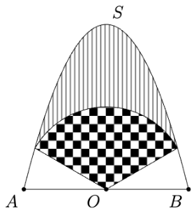
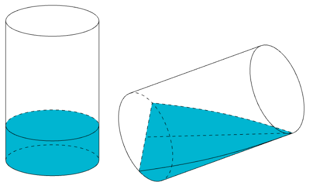

# ĐỀ ÔN TẬP CHÍNH THỨC
### KỲ KHẢO SÁT CHẤT LƯỢNG LỚP 12
### ĐỀ ÔN LUYỆN TỔNG HỢP
**Môn: TOÁN – Lớp 12**  
*Thời gian làm bài: 90 phút (không kể thời gian giao đề)*  
*Biên soạn: Trần Trung Quân*  
**Mã đề thi: 108**  
*(Đề thi gồm có 03 trang)*

---

Họ và tên học sinh: ............................................................................  
Lớp: ............................................................................

---

## PHẦN I. Thí sinh trả lời từ câu 1 đến câu 12. Mỗi câu hỏi thí sinh chỉ chọn một phương án.
*(Mỗi câu trả lời đúng thí sinh được 0,25 điểm)*

**Câu 1.** Cho hàm số $y = f(x)$ có bảng biến thiên như sau:

| $x$ | $-\infty$ | | $-2$ | | $1$ | | $+\infty$ |
| :---: | :---: | :---: | :---: | :---: | :---: | :---: | :---: |
| $f'(x)$ | | $+$ | $0$ | $-$ | $0$ | $+$ | |
| $f(x)$ | $-\infty$ | $\nearrow$ | $3$ | $\searrow$ | $-2$ | $\nearrow$ | $+\infty$ |

Hàm số đã cho đồng biến trên khoảng nào dưới đây?  
A. $(-2; 1)$.  
B. $(1; 3)$.  
C. $(-\infty; -2)$.  
D. $(-2; +\infty)$.

**Câu 2.** Giá trị nhỏ nhất của hàm số $f(x) = x^3 - 3x^2 + 2$ trên đoạn $[0; 3]$ bằng  
A. $2$.  
B. $0$.  
C. $-4$.  
D. $-2$.

**Câu 3.** Biết $F(x) = x^3$ là một nguyên hàm của hàm số $f(x)$ trên $\mathbb{R}$. Giá trị của $\int_{1}^{2} [2 + f(x)]\,\mathrm{d}x$ bằng  
A. $9$.  
B. $7$.  
C. $11$.  
D. $5$.

**Câu 4.** Họ tất cả các nguyên hàm của hàm số $f(x) = e^{2x} + \cos x$ là  
A. $2e^{2x} - \sin x + C$.  
B. $\dfrac{1}{2}e^{2x} - \sin x + C$.  
C. $\dfrac{1}{2}e^{2x} + \sin x + C$.  
D. $e^{2x} + \sin x + C$.

**Câu 5.** Cho $\int_{0}^{2} f(x)\,\mathrm{d}x = 3$ và $\int_{0}^{2} g(x)\,\mathrm{d}x = -1$. Khi đó $\int_{0}^{2} [2f(x) - 3g(x)]\,\mathrm{d}x$ bằng  
A. $3$.  
B. $5$.  
C. $-9$.  
D. $9$.

**Câu 6.** Thể tích $V$ của khối tròn xoay sinh ra khi quay hình phẳng giới hạn bởi đồ thị hàm số $y = e^x$, trục hoành $y = 0$ và hai đường thẳng $x = 0, x = 1$ quanh trục hoành bằng  
A. $\dfrac{\pi(e^2 + 1)}{2}$.  
B. $\dfrac{\pi(e^2 - 1)}{2}$.  
C. $\pi(e^2 - 1)$.  
D. $\dfrac{e^2 - 1}{2}$.

**Câu 7.** Diện tích hình phẳng giới hạn bởi đồ thị hàm số $y = x^2 - 2x$ và trục hoành bằng  
A. $-\dfrac{4}{3}$.  
B. $\dfrac{8}{3}$.  
C. $\dfrac{4}{3}$.  
D. $\dfrac{2}{3}$.

**Câu 8.** Trong không gian $Oxyz$, cho hai điểm $A(1; 2; -1)$ và $B(3; 0; 2)$. Tọa độ của vectơ $\overrightarrow{AB}$ là  
A. $(-2; 2; -3)$.  
B. $(4; 2; 1)$.  
C. $(2; -1; 1)$.  
D. $(2; -2; 3)$.

**Câu 9.** Trong không gian $Oxyz$, cho tam giác $ABC$ có $A(2; -1; 3)$, $B(4; 0; 1)$ và $C(0; 4; -1)$. Tọa độ trọng tâm $G$ của tam giác $ABC$ là  
A. $G(2; 1; 1)$.  
B. $G(6; 3; 3)$.  
C. $G(1; 1; 2)$.  
D. $G(2; 3; 1)$.

**Câu 10.** Trong không gian $Oxyz$, cho hai vectơ $\overrightarrow{u} = (1; 0; -2)$ và $\overrightarrow{v} = (2; -1; 1)$. Tích vô hướng $\overrightarrow{u} \cdot \overrightarrow{v}$ bằng  
A. $4$.  
B. $0$.  
C. $-2$.  
D. $1$.

**Câu 11.** Trong không gian, cho hình lập phương $ABCD.A'B'C'D'$ có cạnh bằng $a$. Giá trị của $|\overrightarrow{AB} + \overrightarrow{AD} + \overrightarrow{AA'}|$ bằng  
A. $a\sqrt{3}$.  
B. $a\sqrt{2}$.  
C. $3a$.  
D. $a$.

**Câu 12.** Một chiếc đèn chùm có khối lượng $m = 6\text{ kg}$ được treo cân bằng trên trần nhà bởi ba sợi dây cáp không giãn. Gọi các lực căng tác dụng lên đèn bởi ba sợi dây lần lượt là $\overrightarrow{F}_1, \overrightarrow{F}_2, \overrightarrow{F}_3$, và trọng lực của đèn là $\overrightarrow{P}$ (lấy gia tốc trọng trường $g = 9,8\text{ m/s}^2$). Do đèn ở trạng thái cân bằng nên độ lớn của hợp lực $\overrightarrow{F}_1 + \overrightarrow{F}_2 + \overrightarrow{F}_3$ bằng  
A. $19,6\text{ N}$.  
B. $58,8\text{ N}$.  
C. $0\text{ N}$.  
D. $117,6\text{ N}$.

---

## PHẦN II. Thí sinh trả lời từ câu 1 đến câu 4. Trong mỗi ý a), b), c), d) ở mỗi câu, thí sinh chọn đúng hoặc sai.
*(Điểm: đúng 1 ý được 0,1 điểm; đúng 2 ý được 0,25 điểm; đúng 3 ý được 0,5 điểm; đúng 4 ý được 1,0 điểm)*

**Câu 1.** Cho hàm số $y = f(x) = \sqrt{e^{2x} - 2e^x + 2}$ có đồ thị là $(C)$. Xét tính đúng sai của các mệnh đề sau:  
a) Tập xác định của hàm số là $D = \mathbb{R}$.  
b) Đạo hàm của hàm số đã cho là $f'(x) = \dfrac{e^x - 1}{\sqrt{e^{2x} - 2e^x + 2}}$.  
c) Hàm số đã cho có một điểm cực đại.  
d) Đồ thị $(C)$ có đường tiệm cận ngang là $y = \sqrt{2}$.

**Câu 2.** Cho hàm số $y = f(x)$ liên tục và không âm trên $\mathbb{R}$ thoả mãn $f(2) = 4$ và $\int_{0}^{2} f(x)\,\mathrm{d}x = 3$. Xét tính đúng sai của các mệnh đề sau:  
a) $\int_{0}^{2} [3f(x) - 2x]\,\mathrm{d}x = 5$.  
b) $\int_{0}^{1} f(2x)\,\mathrm{d}x = 3$.  
c) Thể tích khối tròn xoay tạo thành khi quay hình phẳng giới hạn bởi đồ thị hàm số $y = \sqrt{f(x)}$, trục hoành và hai đường thẳng $x = 0, x = 2$ quanh trục $Ox$ bằng $3\pi$.  
d) Nếu $F(x)$ là một nguyên hàm của $f(x)$ trên $\mathbb{R}$ thoả mãn $F(0) = 1$ thì $F(2) = 4$.

**Câu 3.** Một vật chuyển động thẳng với gia tốc $a(t) = 3t^2 + 2t\text{ (m/s}^2\text{)}$, trong đó $t$ là thời gian tính bằng giây ($t \ge 0$). Vận tốc ban đầu của vật là $v(0) = 5\text{ m/s}$. Xét tính đúng sai của các mệnh đề sau:  
a) Vận tốc của vật tại thời điểm $t$ là $v(t) = t^3 + t^2 + 5\text{ (m/s)}$.  
b) Tại thời điểm $t = 2\text{ s}$, vận tốc của vật đạt $15\text{ m/s}$.  
c) Quãng đường vật đi được từ thời điểm $t = 0\text{ s}$ đến thời điểm $t = 3\text{ s}$ là $44,25\text{ m}$.  
d) Vận tốc trung bình của vật trong khoảng thời gian từ $t = 0\text{ s}$ đến $t = 3\text{ s}$ là $15\text{ m/s}$.

**Câu 4.** Trong không gian với hệ tọa độ $Oxyz$, cho bốn điểm $A(1; 0; 2)$, $B(-1; 1; 3)$, $C(3; 2; 1)$ và $D(3; -2; 3)$. Xét tính đúng sai của các mệnh đề sau:  
a) Tọa độ của vectơ $\overrightarrow{AB}$ là $(-2; 1; 1)$ và độ dài đoạn thẳng $AB$ bằng $\sqrt{6}$.  
b) Vectơ $\overrightarrow{AC} = (2; 2; -1)$ và côsin của góc giữa hai vectơ $\overrightarrow{AB}$ và $\overrightarrow{AC}$ là $\cos(\overrightarrow{AB}, \overrightarrow{AC}) = -\dfrac{\sqrt{6}}{6}$.  
c) Gọi $M$ là chân đường phân giác trong kẻ từ đỉnh $A$ của tam giác $ACD$. Khi đó tọa độ của điểm $M$ là $M(3; 0; 2)$.  
d) Bốn điểm $A, B, C, D$ đồng phẳng.

---

## PHẦN III. Thí sinh trả lời từ câu 1 đến câu 6.
*(Mỗi câu trả lời đúng thí sinh được 0,5 điểm)*

**Câu 1.** Một xưởng sản xuất cần chế tạo một chiếc hộp đựng quà có nắp dạng hình hộp chữ nhật có đáy là hình vuông, thể tích bằng $432\text{ cm}^3$. Chi phí làm nắp và đáy là $8.000\text{ đồng/cm}^2$, trong khi chi phí làm bốn mặt xung quanh là $4.000\text{ đồng/cm}^2$. Để tổng chi phí vật liệu làm chiếc hộp là nhỏ nhất thì chiều cao của chiếc hộp đó phải bằng bao nhiêu centimét?

**Câu 2.** Trên bức tường cần trang trí một hình phẳng dạng parabol đỉnh $S$ như hình vẽ, biết $OS = AB = 4\text{ m}$, $O$ là trung điểm $AB$. Parabol trên được chia thành ba phần để sơn ba màu khác nhau với mức chi phí: phần trên là phần kẻ sọc $140.000\text{ đồng/m}^2$, phần giữa là hình quạt tâm $O$, bán kính $2\text{ m}$ được tô đậm $150.000\text{ đồng/m}^2$, phần còn lại $160.000\text{ đồng/m}^2$. Tổng chi phí để sơn cả ba phần bằng bao nhiêu nghìn đồng? *(kết quả làm tròn đến hàng đơn vị)*.

  

**Câu 3.** Có một cốc thủy tinh hình trụ, bán kính trong lòng đáy cốc là $6\text{ cm}$, chiều cao trong lòng cốc là $10\text{ cm}$ đang đựng một lượng nước. Biết rằng khi nghiêng cốc nước sao cho mép nước vừa lúc chạm miệng cốc thì mặt nước ở đáy cốc trùng với một đường kính đáy cốc (như hình vẽ minh hoạ). Tính thể tích lượng nước có trong cốc (theo đơn vị $\text{cm}^3$).

  

**Câu 4.** Một đoàn tàu cao tốc đang di chuyển với vận tốc $48\text{ m/s}$ thì người lái tàu bắt đầu hãm phanh. Kể từ thời điểm đó, tàu chuyển động chậm dần với gia tốc biến thiên theo thời gian là $a(t) = -2t - 2\text{ (m/s}^2\text{)}$ (với $t$ tính bằng giây). Hỏi từ lúc bắt đầu hãm phanh đến khi tàu dừng hẳn, tàu đã di chuyển được một quãng đường bằng bao nhiêu mét?

**Câu 5.** Trong không gian $Oxyz$ (đơn vị trên mỗi trục toạ độ là $1\text{ km}$), một đài kiểm soát không lưu được đặt tại gốc toạ độ $O(0; 0; 0)$. Một máy bay dân dụng bay theo đường thẳng từ vị trí $A(1; 8; 12)$ đến vị trí $B(7; 4; 12)$. Hỏi trong suốt chặng bay thẳng từ $A$ đến $B$, khoảng cách ngắn nhất từ máy bay đến đài kiểm soát không lưu $O$ bằng bao nhiêu kilômét?

**Câu 6.** Trong không gian với hệ tọa độ $Oxyz$, cho ba điểm $A(2; 1; -1)$, $B(0; 3; 1)$ và $C(4; -1; 3)$. Điểm $M(a; b; 0)$ thuộc mặt phẳng toạ độ $(Oxy)$ sao cho biểu thức $|\overrightarrow{MA} + \overrightarrow{MB} + \overrightarrow{MC}|$ đạt giá trị nhỏ nhất. Giá trị của $a + b$ bằng bao nhiêu?

---

<b>----------------------- HẾT -----------------------</b> 
<i>Học sinh không được sử dụng tài liệu. Cán bộ coi thi không giải thích gì thêm.</i>

