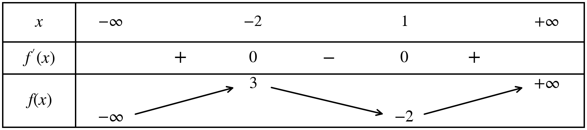

# ĐỀ ÔN TẬP CHÍNH THỨC
### KỲ KHẢO SÁT CHẤT LƯỢNG LỚP 12
### ĐỀ ÔN TẬP GIỮA KỲ I
**Môn: TOÁN – Lớp 12**  
*Thời gian làm bài: 90 phút (không kể thời gian giao đề)*  
*Biên soạn: Trần Trung Quân*  
**Mã đề thi: 112**  
*(Đề thi gồm có 03 trang)*

---

Họ và tên học sinh: ............................................................................  
Lớp: ............................................................................

---

## PHẦN I. Thí sinh trả lời từ câu 1 đến câu 12. Mỗi câu hỏi thí sinh chỉ chọn một phương án.
*(Mỗi câu trả lời đúng thí sinh được 0,25 điểm)*

**Câu 1.** Cho hàm số $y = f(x)$ có bảng biến thiên như sau:

Hàm số đã cho nghịch biến trên khoảng nào dưới đây?  
A. $(-\infty; -1)$.  
B. $(-1; 3)$.  
C. $(3; +\infty)$.  
D. $(-2; 4)$.

**Câu 2.** Cho hàm số $y = f(x)$ có đạo hàm $f'(x) = (x - 1)^2(x + 2)(x - 3)^3$ với mọi $x \in \mathbb{R}$. Số điểm cực trị của hàm số đã cho là  
A. $1$.  
B. $2$.  
C. $3$.  
D. $4$.

**Câu 3.** Giá trị nhỏ nhất của hàm số $f(x) = x^3 - 3x^2 - 9x + 5$ trên đoạn $[0; 4]$ bằng  
A. $5$.  
B. $-15$.  
C. $-22$.  
D. $-27$.

**Câu 4.** Đường tiệm cận đứng của đồ thị hàm số $y = \dfrac{2x - 5}{x + 3}$ là đường thẳng có phương trình  
A. $x = -3$.  
B. $x = 3$.  
C. $y = 2$.  
D. $y = -3$.

**Câu 5.** Đường tiệm cận xiên của đồ thị hàm số $y = \dfrac{x^2 - 3x + 5}{x - 2}$ là đường thẳng có phương trình  
A. $y = x - 1$.  
B. $y = x + 1$.  
C. $y = x - 3$.  
D. $y = 2x - 1$.

**Câu 6.** Đồ thị của hàm số nào dưới đây có dạng như đường cong trong hình bên dưới? (Biết đường cong đi qua điểm $(0; 1)$, đạt cực đại tại $(-1; 3)$ và đạt cực tiểu tại $(1; -1)$).  
A. $y = -x^3 + 3x + 1$.  
B. $y = x^3 - 3x + 1$.  
C. $y = x^3 - 3x - 1$.  
D. $y = x^4 - 2x^2 + 1$.

**Câu 7.** Cho hàm số $y = f(x)$ liên tục trên $\mathbb{R}$ và có bảng biến thiên như sau:

Số nghiệm thực phân biệt của phương trình $2f(x) - 1 = 0$ là  
A. $1$.  
B. $2$.  
C. $3$.  
D. $4$.

**Câu 8.** Tọa độ giao điểm của đồ thị hàm số $y = \dfrac{x - 3}{x + 1}$ với trục tung là  
A. $(0; -3)$.  
B. $(3; 0)$.  
C. $(0; 3)$.  
D. $(-1; 0)$.

**Câu 9.** Tổng số đường tiệm cận đứng và tiệm cận ngang của đồ thị hàm số $y = \dfrac{x - 1}{x^2 - 3x + 2}$ là  
A. $1$.  
B. $2$.  
C. $3$.  
D. $0$.

**Câu 10.** Tọa độ điểm cực đại của đồ thị hàm số $y = -x^3 + 3x^2 + 2$ là  
A. $(0; 2)$.  
B. $(2; 6)$.  
C. $(2; 2)$.  
D. $(6; 2)$.

**Câu 11.** Một chất điểm chuyển động thẳng có phương trình tọa độ $s(t) = -t^3 + 6t^2 + 15t + 2$, trong đó $t$ tính bằng giây ($t \ge 0$) và $s$ tính bằng mét. Vận tốc tức thời của chất điểm đạt giá trị lớn nhất tại thời điểm $t$ bằng  
A. $t = 2\text{ s}$.  
B. $t = 4\text{ s}$.  
C. $t = 5\text{ s}$.  
D. $t = 1\text{ s}$.

**Câu 12.** Có bao nhiêu giá trị nguyên của tham số $m \in [-100; 100]$ để hàm số $y = \dfrac{x - 3}{x - m}$ đồng biến trên khoảng $(4; +\infty)$?  
A. $103$.  
B. $104$.  
C. $102$.  
D. $97$.

---

## PHẦN II. Thí sinh trả lời từ câu 1 đến câu 4. Trong mỗi ý a), b), c), d) ở mỗi câu, thí sinh chọn đúng hoặc sai.
*(Điểm: đúng 1 ý được 0,1 điểm; đúng 2 ý được 0,25 điểm; đúng 3 ý được 0,5 điểm; đúng 4 ý được 1,0 điểm)*

**Câu 1.** Cho hàm số $y = f(x) = \dfrac{x^2 - 3x + 3}{x - 1}$ có đồ thị là $(C)$. Xét tính đúng sai của các mệnh đề sau:  
a) Hàm số đồng biến trên các khoảng $(-\infty; 0)$ và $(2; +\infty)$.  
b) Đồ thị $(C)$ có đường tiệm cận đứng là $x = 1$ và đường tiệm cận xiên là $y = x - 2$.  
c) Tọa độ tâm đối xứng của đồ thị $(C)$ là giao điểm của hai đường tiệm cận $I(1; 1)$.  
d) Khoảng cách giữa hai điểm cực trị của đồ thị hàm số $(C)$ bằng $2\sqrt{5}$.

**Câu 2.** Cho hàm số $y = f(x) = \dfrac{1}{3}x^3 - mx^2 + (m^2 - 4)x + 1$ (với $m$ là tham số thực). Xét tính đúng sai của các mệnh đề sau:  
a) Với mọi $m \in \mathbb{R}$, hàm số luôn có hai điểm cực trị phân biệt.  
b) Hai điểm cực trị của hàm số đã cho là $x_1 = m - 2$ và $x_2 = m + 2$.  
c) Hàm số đồng biến trên khoảng $(5; +\infty)$ khi và chỉ khi $m \le 3$.  
d) Có đúng hai giá trị của tham số $m$ để hai hoành độ cực trị $x_1, x_2$ thoả mãn $x_1^2 + x_2^2 = 20$.

**Câu 3.** Khi một bệnh nhân được tiêm một liều thuốc kháng sinh vào cơ thể, nồng độ của thuốc trong máu sau $t$ giờ (kể từ khi bắt đầu tiêm) được mô tả bởi hàm số:
$$C(t) = \dfrac{8t}{t^2 + 4}\quad (\text{mg/L}),\quad t \ge 0.$$
Xét tính đúng sai của các mệnh đề sau:  
a) Tại thời điểm ban đầu ($t = 0$), nồng độ thuốc trong máu của bệnh nhân bằng $0\text{ mg/L}$.  
b) Nồng độ thuốc trong máu của bệnh nhân đạt giá trị lớn nhất sau khi tiêm $2\text{ giờ}$.  
c) Nồng độ thuốc lớn nhất trong máu của bệnh nhân ghi nhận được bằng $4\text{ mg/L}$.  
d) Trong khoảng thời gian từ $t = 2\text{ giờ}$ trở đi, nồng độ thuốc trong máu giảm dần theo thời gian.

**Câu 4.** Hai trụ đèn cao áp đặt cố định vuông góc với mặt đất bằng phẳng lần lượt có chiều cao là $AH = 6\text{ m}$ và $BK = 12\text{ m}$. Khoảng cách giữa hai chân trụ đèn là $HK = 24\text{ m}$. Để phục vụ chiếu sáng trang trí, một kỹ sư điện muốn đóng một cọc chốt tại điểm $M$ trên đoạn thẳng $HK$ nối hai chân trụ để giăng hai dây cáp thẳng nối từ $M$ đến đỉnh $A$ và từ $M$ đến đỉnh $B$. Đặt khoảng cách $HM = x\text{ (m)}$ với $0 \le x \le 24$. Xét tính đúng sai của các mệnh đề sau:  
a) Chiều dài đoạn dây cáp $BM$ tính theo $x$ là $BM = \sqrt{(24 - x)^2 + 144}\text{ (m)}$.  
b) Nếu đóng cọc chốt tại vị trí trung điểm của đoạn thẳng $HK$ thì tổng chiều dài hai đoạn dây cáp bằng $18\sqrt{2}\text{ m}$.  
c) Tổng chiều dài hai đoạn dây cáp là ngắn nhất khi cọc chốt $M$ cách chân trụ $H$ một khoảng $8\text{ m}$.  
d) Chiều dài ngắn nhất của tổng hai đoạn dây cáp giăng từ $M$ đến hai đỉnh trụ đèn bằng $30\text{ m}$.

---

## PHẦN III. Thí sinh trả lời từ câu 1 đến câu 6.
*(Mỗi câu trả lời đúng thí sinh được 0,5 điểm)*

**Câu 1.** Cho hàm số $y = x^3 - 3(m + 1)x^2 + 3m(m + 2)x + 2026$. Gọi $S$ là tập hợp tất cả các giá trị nguyên của tham số $m \in [-100; 100]$ để hàm số đã cho đồng biến trên khoảng $(2; 6)$. Tính tổng tất cả các phần tử của tập hợp $S$.

**Câu 2.** Một doanh nghiệp sản xuất độc quyền một loại sản phẩm. Nếu doanh nghiệp sản xuất và bán ra $x$ sản phẩm mỗi ngày ($0 < x \le 200$) thì giá bán mỗi sản phẩm là $p(x) = 400 - x\text{ (nghìn đồng)}$, và tổng chi phí sản xuất $x$ sản phẩm đó là $C(x) = x^2 + 40x + 2000\text{ (nghìn đồng)}$. Để điều tiết thị trường, Nhà nước áp dụng mức thuế phụ thu là $t\text{ (nghìn đồng)}$ trên mỗi đơn vị sản phẩm bán ra ($0 < t < 360$). Biết rằng doanh nghiệp luôn chọn mức sản lượng $x$ để tối đa hóa lợi nhuận sau khi nộp thuế. Để tổng số tiền thuế thu được từ doanh nghiệp trong một ngày là lớn nhất, Nhà nước cần ấn định mức thuế $t$ bằng bao nhiêu nghìn đồng?

**Câu 3.** Tìm giá trị của tham số thực $m$ để giá trị lớn nhất của hàm số $f(x) = \dfrac{2x + m}{x - 1}$ trên đoạn $[2; 4]$ bằng $5$.

**Câu 4.** Nhà máy A chuyên sản xuất một loại sản phẩm cho nhà máy B; Hai nhà máy thỏa thuận rằng, hàng tháng nhà máy A cung cấp cho nhà máy B số lượng sản phẩm theo đơn đặt hàng của nhà máy B (tối đa $90\text{ tấn sản phẩm}$). Nếu số lượng đặt hàng là $x\text{ tấn sản phẩm}$ thì giá bán cho mỗi tấn sản phẩm là $P(x) = 90 - 0{,}01x^2\text{ (đơn vị triệu đồng)}$. Chi phí để nhà máy A sản xuất $x\text{ tấn sản phẩm}$ trong một tháng là $C(x) = \dfrac{1}{2}(200 + 27x)\text{ (đơn vị triệu đồng)}$, thuế giá trị gia tăng mà nhà máy A phải đóng cho nhà nước là $10\%$ tổng doanh thu mỗi tháng. Hỏi mỗi tháng nhà máy A thu được lợi nhuận cao nhất bao nhiêu triệu đồng (sau khi đã trừ thuế giá trị gia tăng)?

**Câu 5.** Có ba ngôi nhà $A, B, C$ mà khoảng cách giữa từng cặp ngôi nhà đều bằng $4\text{ km}$. Một ngôi nhà thứ tư $D$ ở bên ngoài vùng tam giác $ABC$, mà góc nhìn của $D$ đối với hai ngôi nhà $A, B$ là $120^\circ$ và khoảng cách từ $D$ đến $A$ và $B$ bằng nhau (như hình vẽ bên dưới). Người ta muốn chọn điểm $M$ nằm giữa $B$ và $C$, để làm con đường đi từ $C$ đến $M$ rồi từ $M$ đến $D$. Biết giá tiền làm đường trên đoạn $BC$ là $200\text{ triệu đồng/km}$ và trên đoạn $MD$ là $400\text{ triệu đồng/km}$. Hỏi tổng chi phí nhỏ nhất để làm con đường đó là bao nhiêu triệu đồng?

**Câu 6.** Một hộ gia đình dự định xây một bể chứa nước sinh hoạt hình hộp chữ nhật không nắp có thể tích bằng $60\text{ m}^3$. Đáy bể là hình chữ nhật có chiều dài gấp đôi chiều rộng. Biết chi phí vật liệu xây đáy bể là $500.000\text{ đồng/m}^2$ và chi phí xây bốn mặt thành xung quanh bể là $300.000\text{ đồng/m}^2$. Hỏi chi phí nhỏ nhất mà hộ gia đình cần bỏ ra để hoàn thành bể nước đó là bao nhiêu triệu đồng?

---

---------- HẾT ----------

Thí sinh không được sử dụng tài liệu. Cán bộ coi thi không giải thích gì thêm.

