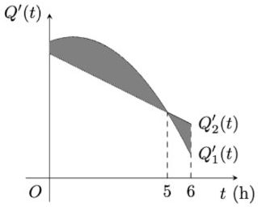
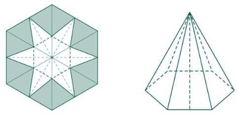
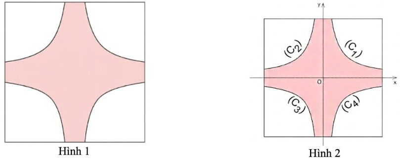
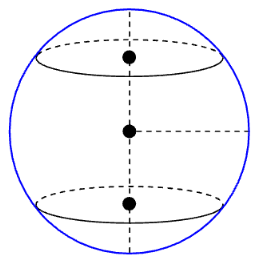

# ĐỀ ÔN TẬP CHÍNH THỨC
### KỲ KHẢO SÁT CHẤT LƯỢNG LỚP 12
### ĐỀ ÔN LUYỆN TỔNG HỢP
**Môn: TOÁN – LỚP 12**  
*Thời gian làm bài: 90 phút (không kể thời gian giao đề)*  
*Biên soạn: Trần Trung Quân*  
**Mã đề thi: 114**  
*(Đề thi gồm có 04 trang)*

---

Họ và tên học sinh: ............................................................................  
Lớp: ............................................................................

---

## PHẦN I. Thí sinh trả lời từ câu 1 đến câu 12. Mỗi câu hỏi thí sinh chỉ chọn một phương án.
*(Mỗi câu trả lời đúng thí sinh được 0,25 điểm)*

**Câu 1.** Cho hàm số $y = f(x)$ có đạo hàm $f'(x) = x(x - 1)^2 (x + 2)^3$ với mọi $x \in \mathbb{R}$. Số điểm cực trị của hàm số đã cho là  
A. $3$.  
B. $1$.  
C. $2$.  
D. $6$.

**Câu 2.** Cho hàm số $y = f(x)$ xác định trên $\mathbb{R} \setminus \{2\}$ thỏa mãn $\lim_{x \to -\infty} f(x) = 1$, $\lim_{x \to +\infty} f(x) = 3$, $\lim_{x \to 2^+} f(x) = +\infty$ và $\lim_{x \to 2^-} f(x) = -1$. Tổng số đường tiệm cận đứng và tiệm cận ngang của đồ thị hàm số đã cho là  
A. $3$.  
B. $2$.  
C. $4$.  
D. $1$.

**Câu 3.** Có bao nhiêu giá trị nguyên của tham số $m \in [-5; 5]$ để hàm số $y = \dfrac{x - 2}{x + m}$ đồng biến trên từng khoảng xác định?  
A. $5$.  
B. $8$.  
C. $6$.  
D. $7$.

**Câu 4.** Cho tứ diện đều $ABCD$ có cạnh bằng $a$. Góc giữa hai vectơ $\overrightarrow{AB}$ và $\overrightarrow{CD}$ bằng  
A. $60^\circ$.  
B. $90^\circ$.  
C. $45^\circ$.  
D. $120^\circ$.

**Câu 5.** Trong không gian với hệ tọa độ $Oxyz$, cho điểm $A(1; 2; 3)$ và mặt phẳng $(P): 2x + y - 2z + 11 = 0$. Tọa độ hình chiếu vuông góc $H$ của điểm $A$ trên mặt phẳng $(P)$ là  
A. $H(-1; 1; 5)$.  
B. $H(3; 3; 1)$.  
C. $H(-1; 3; 5)$.  
D. $H(1; -1; 5)$.

**Câu 6.** Trong không gian với hệ tọa độ $Oxyz$, cho bốn điểm $A(1; 0; 0)$, $B(0; 2; 0)$, $C(0; 0; 3)$ và $D(2; 2; 3)$. Thể tích của khối tứ diện $ABCD$ bằng  
A. $6$.  
B. $18$.  
C. $1$.  
D. $3$.

**Câu 7.** Trong không gian với hệ tọa độ $Oxyz$, cho mặt cầu $(S): (x - 1)^2 + (y + 2)^2 + (z - 3)^2 = 9$ và mặt phẳng $(\alpha): 2x - 2y + z + m = 0$. Giá trị của tham số $m$ để mặt phẳng $(\alpha)$ tiếp xúc với mặt cầu $(S)$ là  
A. $m = 0$ hoặc $m = 18$.  
B. $m = 0$ hoặc $m = -18$.  
C. $m = 9$ hoặc $m = -9$.  
D. $m = 3$ hoặc $m = -15$.

**Câu 8.** Trong không gian với hệ tọa độ $Oxyz$, tọa độ giao điểm $M$ của đường thẳng $d: \dfrac{x - 1}{2} = \dfrac{y + 2}{-1} = \dfrac{z - 3}{1}$ và mặt phẳng $(P): x + 2y + z - 1 = 0$ là  
A. $M(1; -2; 3)$.  
B. $M(-1; -1; 2)$.  
C. $M(3; -3; 4)$.  
D. $M(5; -4; 5)$.

**Câu 9.** Trong không gian với hệ tọa độ $Oxyz$, sin của góc giữa đường thẳng $d: \dfrac{x - 1}{2} = \dfrac{y + 1}{1} = \dfrac{z}{-2}$ và mặt phẳng $(P): 2x + 2y - z - 5 = 0$ bằng  
A. $\dfrac{4}{9}$.  
B. $\dfrac{8}{9}$.  
C. $\dfrac{\sqrt{17}}{9}$.  
D. $\dfrac{2}{3}$.

**Câu 10.** Cho hàm số $f(x)$ liên tục trên đoạn $[0; 4]$ thỏa mãn $\int_0^4 f(x)\,\mathrm{d}x = 8$. Giá trị của tích phân $I = \int_0^2 f(2x)\,\mathrm{d}x$ bằng  
A. $4$.  
B. $16$.  
C. $8$.  
D. $2$.

**Câu 11.** Giá trị của tích phân $I = \int_0^1 (2x + 1) e^x\,\mathrm{d}x$ bằng  
A. $e - 1$.  
B. $2e + 1$.  
C. $3e - 1$.  
D. $e + 1$.

**Câu 12.** Diện tích hình phẳng giới hạn bởi đồ thị hàm số $y = 3x - x^2$ và trục hoành $Ox$ bằng  
A. $\dfrac{9}{4}$.  
B. $9$.  
C. $\dfrac{9}{2}$.  
D. $\dfrac{27}{2}$.

---

## PHẦN II. Thí sinh trả lời từ câu 1 đến câu 4. Trong mỗi ý a), b), c), d) ở mỗi câu, thí sinh chọn đúng hoặc sai.
*(Điểm: đúng 1 ý được 0,1 điểm; đúng 2 ý được 0,25 điểm; đúng 3 ý được 0,5 điểm; đúng 4 ý được 1,0 điểm)*

**Câu 1.** Trong một nghiên cứu dịch tễ học, tổng số ca mắc một bệnh truyền nhiễm trong một cộng đồng dân cư sau $t$ ngày (kể từ khi ca bệnh đầu tiên xuất hiện) được mô hình hóa bởi hàm số Logistic: $N(t) = \dfrac{1000}{1 + 9e^{-0,2t}}$ ($0 \le t \le 60$). Xét tính đúng sai của các mệnh đề sau:  
a) Số người bị nhiễm bệnh ban đầu tại thời điểm $t = 0$ là $100$ người.  
b) Đạo hàm $N'(t) < 0$ với mọi $t \ge 0$, tức là tổng số ca nhiễm luôn giảm theo thời gian.  
c) Tốc độ lây lan dịch bệnh (số ca nhiễm mới gia tăng mỗi ngày $N'(t)$) đạt giá trị lớn nhất khi tổng số ca nhiễm đạt $500$ người.  
d) Khi thời gian bùng phát dịch kéo dài ($t \to +\infty$), tổng số ca nhiễm bệnh trong cộng đồng có thể vượt quá $1200$ người.

**Câu 2.** Trong không gian với hệ tọa độ $Oxyz$ (đơn vị đo trên các trục là kilômét), một ngọn hải đăng đặt tại đảo có tọa độ $A(2; 3; 1)$. Một tàu ngầm di chuyển dưới mặt nước biển theo đường thẳng $d$ có phương trình tham số: $\begin{cases} x = 6 - 2t \\ y = -1 + 2t \\ z = -2 + t \end{cases}$ ($t \ge 0$, $t$ tính bằng giờ). Mặt biển được lấy trùng với mặt phẳng tọa độ $(Oxy): z = 0$. Xét tính đúng sai của các mệnh đề sau:  
a) Tàu ngầm nổi lên mặt biển tại điểm có tọa độ $M(2; 3; 0)$.  
b) Vận tốc di chuyển của tàu ngầm bằng $3\text{ km/h}$.  
c) Sin của góc tạo bởi đường di chuyển $d$ của tàu ngầm và mặt biển $(Oxy)$ bằng $\dfrac{2}{3}$.  
d) Khoảng cách từ ngọn hải đăng $A(2; 3; 1)$ đến vị trí tàu ngầm tại thời điểm tàu nổi lên mặt biển bằng $1\text{ km}$.

**Câu 3.** Hình vẽ bên mô tả hiệu suất làm việc của hai công nhân trong một nhà máy trong thời gian $6\text{ giờ}$. Công nhân A đang sản xuất với hiệu suất $Q_1'(t) = -2t^2 + 4t + 58$ sản phẩm mỗi giờ, trong khi công nhân B đang sản xuất với hiệu suất $Q_2'(t) = 53 + at$ sản phẩm mỗi giờ ($a \in \mathbb{R}$). Biết rằng hàm $Q_1(t)$ và $Q_2(t)$ mô phỏng số lượng sản phẩm mới làm được của công nhân A và công nhân B sau $t\text{ giờ}$. Xét tính đúng sai của các mệnh đề sau:  

a) Hiệu suất cực đại của công nhân A là $60$ sản phẩm mỗi giờ.  
b) Phần diện tích tô đậm biểu diễn cho tổng số lượng sản phẩm mới mà 2 công nhân làm được trong $6\text{ giờ}$.  
c) Sau $5\text{ giờ}$ số lượng sản phẩm mới mà công nhân A hoàn thành nhiều hơn công nhân B là $54$ sản phẩm (kết quả làm tròn đến hàng đơn vị).  
d) Sau $6\text{ giờ}$ làm việc tổng số lượng sản phẩm mới mà 2 công nhân hoàn thành là $502$ sản phẩm.

**Câu 4.** Trong không gian với hệ tọa độ $Oxyz$ (đơn vị đo trên các trục là mét), một mái che sân khấu ngoài trời được thiết kế dạng hình chóp tứ giác đều $S.ABCD$ với đỉnh $S$ hướng lên trên. Mặt phẳng đáy $(ABCD)$ nằm trên mặt đất $(Oxy): z = 0$ có tâm trùng với gốc tọa độ $O(0; 0; 0)$ và các cạnh song song với các trục tọa độ ($AB \parallel Ox$). Độ dài cạnh đáy bằng $12\text{ m}$ và chiều cao của mái che là $SO = 8\text{ m}$ (đỉnh $S$ nằm trên phần dương của trục $Oz$). Xét tính đúng sai của các mệnh đề sau:  
a) Tọa độ của đỉnh $S$ là $S(0; 0; 8)$ và điểm $C$ có tọa độ là $(6; 6; 0)$.  
b) Độ dài đường cao của mặt bên $(SCD)$ kẻ từ đỉnh $S$ bằng $12\text{ m}$.  
c) Cosin của góc $\alpha$ tạo bởi mặt bên $(SCD)$ và mặt phẳng đáy $(ABCD)$ bằng $\dfrac{3}{5}$.  
d) Gọi $M$ là trung điểm của $SA$, khoảng cách từ điểm $B$ đến mặt phẳng $(MCD)$ bằng $\dfrac{48}{\sqrt{97}}\text{ m}$.

---

## PHẦN III. Thí sinh trả lời từ câu 1 đến câu 6.
*(Mỗi câu trả lời đúng thí sinh được 0,5 điểm)*

**Câu 1.** Từ một tấm bìa lục giác đều cạnh bằng $30\text{ cm}$, bạn Bình muốn làm một hình chóp lục giác đều bằng cách cắt bỏ phần tô đậm và dán các mép lại với nhau (các mối ghép nối có kích thước không đáng kể, tham khảo hình vẽ). Để thể tích khối chóp lục giác đều tạo thành lớn nhất thì phần diện tích bạn Bình cắt đi là bao nhiêu $\text{cm}^2$ (không làm tròn kết quả các phép tính trung gian, chỉ làm tròn kết quả cuối cùng đến hàng đơn vị)?

**Câu 2.** Một viên gạch hình vuông cạnh $10\text{ dm}$ có trang trí và sơn màu hồng ở phần tô đậm như hình 1. Hình 2 là bản vẽ thiết kế viên gạch đó trong hệ tọa độ $Oxy$ với một đơn vị của mỗi trục ứng với $1\text{ dm}$, $O$ là tâm hình vuông, các trục tọa độ lần lượt song song với các cạnh của hình vuông. Lúc này, mỗi hình $(C_1), (C_2), (C_3), (C_4)$ là một phần của một trong hai đường hypebol $y = -\dfrac{5}{x}$, $y = \dfrac{5}{x}$. Diện tích phần sơn màu hồng là bao nhiêu $\text{dm}^2$ (làm tròn kết quả đến hàng phần mười)?

**Câu 3.** Một khối cầu có bán kính là $5\text{ (dm)}$, người ta cắt bỏ hai phần của khối cầu bằng hai mặt phẳng song song cùng vuông góc đường kính và cách tâm một khoảng $3\text{ (dm)}$ để làm một chiếc lu đựng nước (như hình vẽ). Tính thể tích mà chiếc lu chứa được (kết quả làm tròn đến hàng đơn vị).

**Câu 4.** Trong không gian với hệ tọa độ $Oxyz$, cho mặt cầu $(S): (x - 1)^2 + (y - 2)^2 + (z + 1)^2 = 9$ và hai điểm $A(3; 2; 1)$, $B(-1; 0; 0)$. Điểm $M$ di động trên mặt cầu $(S)$. Tìm giá trị lớn nhất của biểu thức $P = 2MA^2 - MB^2$.

**Câu 5.** Trong không gian với hệ tọa độ $Oxyz$ (đơn vị đo trên các trục tọa độ là kilômét), đài kiểm soát không lưu theo dõi hai máy bay thương mại $A$ và $B$ đang bay thẳng đều ở cùng độ cao $10\text{ km}$. Tại thời điểm $t = 0\text{ (phút)}$, máy bay $A$ ở vị trí $A_0(10; 40; 10)$ và bay với vectơ vận tốc $\overrightarrow{v_A} = (12; 6; 0)\text{ (km/phút)}$. Cùng thời điểm đó, máy bay $B$ ở vị trí $B_0(26; 27; 10)$ và bay với vectơ vận tốc $\overrightarrow{v_B} = (6; 14; 0)\text{ (km/phút)}$. Khoảng cách ngắn nhất giữa hai máy bay trong quá trình bay bằng bao nhiêu kilômét?

**Câu 6.** Trong không gian với hệ tọa độ $Oxyz$, cho mặt cầu $(S): (x - 1)^2 + (y - 2)^2 + (z + 1)^2 = 9$ và điểm $A(4; 6; -1)$. Từ điểm $A$ kẻ các đường thẳng tiếp xúc với mặt cầu $(S)$, tập hợp tất cả các tiếp điểm tạo thành một đường tròn $(C)$. Bán kính của đường tròn $(C)$ bằng bao nhiêu?

---

---------- HẾT ----------

Thí sinh không được sử dụng tài liệu. Cán bộ coi thi không giải thích gì thêm.

