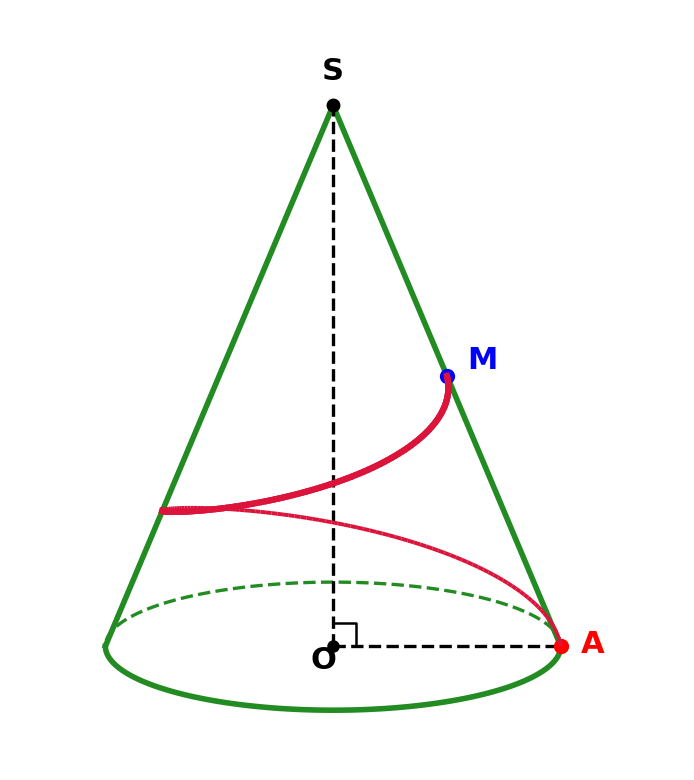
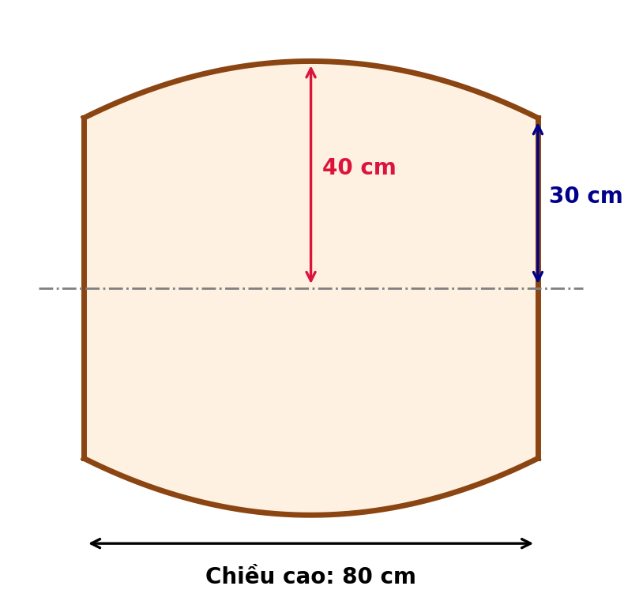

# ĐỀ ÔN TẬP CHÍNH THỨC
### KỲ KHẢO SÁT CHẤT LƯỢNG LỚP 12
### ĐỀ ÔN LUYỆN TỔNG HỢP
**Môn: TOÁN – LỚP 12**  
*Thời gian làm bài: 90 phút (không kể thời gian giao đề)*  
*Biên soạn: Trần Trung Quân*  
**Mã đề thi: 115**  
*(Đề thi gồm có 04 trang)*

---

Họ và tên học sinh: ............................................................................  
Lớp: ............................................................................

---

## PHẦN I. Thí sinh trả lời từ câu 1 đến câu 12. Mỗi câu hỏi thí sinh chỉ chọn một phương án.
*(Mỗi câu trả lời đúng thí sinh được 0,25 điểm)*

**Câu 1.** Cho hàm số $y = \dfrac{2x^2 - 3x + 5}{x - 1}$. Đường tiệm cận xiên của đồ thị hàm số có phương trình là $y = ax + b$. Giá trị của biểu thức $a + b$ bằng  
A. $-1$.  
B. $3$.  
C. $1$.  
D. $2$.

**Câu 2.** Một doanh nghiệp sản xuất một loại sản phẩm với tổng chi phí sản xuất $x$ tấn sản phẩm được mô hình hóa bởi hàm số $C(x) = x^2 + 40x + 1600$ (triệu đồng), với $x > 0$. Chi phí trung bình để sản xuất một tấn sản phẩm là $\bar{C}(x) = \dfrac{C(x)}{x}$. Để chi phí trung bình trên mỗi tấn sản phẩm là nhỏ nhất thì doanh nghiệp cần sản xuất bao nhiêu tấn sản phẩm?  
A. $40$ tấn.  
B. $50$ tấn.  
C. $30$ tấn.  
D. $20$ tấn.

**Câu 3.** Cho hàm số $y = \dfrac{x^2 - 2x + 3}{x + 1}$. Tọa độ tâm đối xứng $I$ của đồ thị hàm số (giao điểm của hai đường tiệm cận) là  
A. $I(1; -2)$.  
B. $I(-1; 4)$.  
C. $I(1; 2)$.  
D. $I(-1; -4)$.

**Câu 4.** Ba lực $\overrightarrow{F_1}, \overrightarrow{F_2}, \overrightarrow{F_3}$ cùng tác dụng vào một chất điểm cân bằng tại gốc $O$. Biết rằng $|\overrightarrow{F_1}| = 10\text{ N}$, $|\overrightarrow{F_2}| = 10\text{ N}$ và góc giữa hai lực $\overrightarrow{F_1}$ và $\overrightarrow{F_2}$ bằng $120^\circ$. Độ lớn của lực $\overrightarrow{F_3}$ bằng  
A. $10\sqrt{3}\text{ N}$.  
B. $10\text{ N}$.  
C. $20\text{ N}$.  
D. $5\sqrt{3}\text{ N}$.

**Câu 5.** Trong không gian với hệ tọa độ $Oxyz$, cho ba điểm $A(1; 0; 0)$, $B(0; 2; 0)$, $C(0; 0; 4)$. Diện tích của tam giác $ABC$ bằng  
A. $\sqrt{21}$.  
B. $\sqrt{42}$.  
C. $2\sqrt{21}$.  
D. $\dfrac{\sqrt{21}}{2}$.

**Câu 6.** Trong không gian với hệ tọa độ $Oxyz$, phương trình mặt cầu có tâm $I(2; -1; 3)$ và tiếp xúc với trục $Oz$ là  
A. $(x + 2)^2 + (y - 1)^2 + (z + 3)^2 = 5$.  
B. $(x - 2)^2 + (y + 1)^2 + (z - 3)^2 = 13$.  
C. $(x - 2)^2 + (y + 1)^2 + (z - 3)^2 = 9$.  
D. $(x - 2)^2 + (y + 1)^2 + (z - 3)^2 = 5$.

**Câu 7.** Trong không gian với hệ tọa độ $Oxyz$, cho hai đường thẳng $d_1: \dfrac{x - 1}{2} = \dfrac{y + 1}{1} = \dfrac{z - 2}{-1}$ và $d_2: \dfrac{x + 1}{1} = \dfrac{y - 2}{2} = \dfrac{z + 1}{1}$. Vị trí tương đối của hai đường thẳng $d_1$ và $d_2$ là  
A. Song song.  
B. Chéo nhau.  
C. Cắt nhau.  
D. Trùng nhau.

**Câu 8.** Trong không gian với hệ tọa độ $Oxyz$, cho điểm $M(1; -2; 3)$. Hình chiếu vuông góc của điểm $M$ lên trục tọa độ $Oy$ có tọa độ là  
A. $(1; 0; 0)$.  
B. $(0; 0; 3)$.  
C. $(0; -2; 0)$.  
D. $(1; 0; 3)$.

**Câu 9.** Trong không gian với hệ tọa độ $Oxyz$, cho điểm $A(3; 3; -3)$ và đường thẳng $d: \dfrac{x - 1}{1} = \dfrac{y - 2}{2} = \dfrac{z + 1}{2}$. Khoảng cách từ điểm $A$ đến đường thẳng $d$ bằng  
A. $2$.  
B. $3$.  
C. $\sqrt{5}$.  
D. $\sqrt{13}$.

**Câu 10.** Cho hàm số $f(x)$ liên tục trên $\mathbb{R}$ thỏa mãn $\int_0^3 f(x)\,\mathrm{d}x = 7$ và $F(x)$ là một nguyên hàm của $f(x)$ thỏa mãn $F(0) = 2$. Giá trị của $F(3)$ bằng  
A. $9$.  
B. $5$.  
C. $-5$.  
D. $14$.

**Câu 11.** Một vật chuyển động với gia tốc $a(t) = 6t - 2\text{ (m/s}^2\text{)}$. Vận tốc ban đầu của vật tại thời điểm $t = 0$ là $v(0) = 4\text{ m/s}$. Quãng đường vật đi được sau $3\text{ giây}$ đầu tiên bằng  
A. $36\text{ m}$.  
B. $24\text{ m}$.  
C. $28\text{ m}$.  
D. $30\text{ m}$.

**Câu 12.** Thể tích của khối tròn xoay sinh ra khi quay hình phẳng giới hạn bởi đường cong $y = \sqrt{x}e^x$, trục hoành $Ox$ và hai đường thẳng $x = 0, x = 1$ quanh trục hoành $Ox$ bằng  
A. $\dfrac{\pi(e^2 - 1)}{4}$.  
B. $\dfrac{\pi(e^2 + 1)}{2}$.  
C. $\dfrac{\pi(e^2 + 1)}{4}$.  
D. $\pi(e^2 + 1)$.

---

## PHẦN II. Thí sinh trả lời từ câu 1 đến câu 4. Trong mỗi ý a), b), c), d) ở mỗi câu, thí sinh chọn đúng hoặc sai.
*(Điểm: đúng 1 ý được 0,1 điểm; đúng 2 ý được 0,25 điểm; đúng 3 ý được 0,5 điểm; đúng 4 ý được 1,0 điểm)*

**Câu 1.** Trong một trang trại nuôi tôm công nghệ cao, nồng độ oxy hòa tan trong nước $C(t)$ (đơn vị: mg/L) sau khi bật máy sục khí $t$ giờ ($0 \le t \le 12$) được mô tả bởi hàm số:
$$C(t) = 4 + \dfrac{8t}{t^2 + 4}$$
Xét tính đúng sai của các mệnh đề sau:  
a) Nồng độ oxy hòa tan ban đầu khi chưa bật máy sục khí ($t = 0$) là $4\text{ mg/L}$.  
b) Nồng độ oxy hòa tan trong nước luôn tăng trong suốt thời gian $12\text{ giờ}$ sục khí.  
c) Sau khi bật máy sục khí $2\text{ giờ}$, nồng độ oxy hòa tan trong nước đạt giá trị cực đại bằng $6\text{ mg/L}$.  
d) Trong suốt $12\text{ giờ}$ theo dõi, nồng độ oxy hòa tan trong hồ luôn duy trì ở mức trên $4,8\text{ mg/L}$.

**Câu 2.** Trong không gian với hệ tọa độ $Oxyz$ (đơn vị đo trên các trục là mét), một cần cẩu tháp có chân đế đặt tại gốc tọa độ $O(0; 0; 0)$ trên mặt đất phẳng $(Oxy): z = 0$. Trục tháp thẳng đứng trùng với phần dương trục $Oz$. Cần cẩu có tay cần quay ngang, đầu mút tay cần tại thời điểm ban đầu ở vị trí $M(12; 16; 30)$. Cáp tải của cần cẩu móc vào một kiện hàng đặt tại vị trí $B(12; 16; 0)$ trên mặt đất. Cần cẩu nâng kiện hàng thẳng đứng từ $B$ lên vị trí $C(12; 16; 10)$, sau đó di chuyển đều kiện hàng theo phương ngang đến vị trí $D(0; 25; 10)$ với vận tốc $1,5\text{ m/s}$. Xét tính đúng sai của các mệnh đề sau:  
a) Khoảng cách từ đầu mút tay cần $M$ đến trục quay thẳng đứng $Oz$ của cần cẩu bằng $20\text{ m}$.  
b) Thời gian để cần cẩu di chuyển kiện hàng từ vị trí $C$ sang vị trí $D$ là $10\text{ giây}$.  
c) Trên trục tháp ở độ cao $10\text{ m}$ có gắn một đèn tín hiệu $E(0; 0; 10)$. Trong quá trình kiện hàng di chuyển thẳng từ $C$ đến $D$, khoảng cách ngắn nhất từ đèn tín hiệu $E$ đến kiện hàng bằng $15\text{ m}$.  
d) Sin của góc tạo bởi sợi dây cáp nối từ đầu cần $M$ đến kiện hàng tại vị trí $D$ và mặt phẳng nằm ngang $(Oxy)$ bằng $\dfrac{4}{5}$.

**Câu 3.** Lưu lượng nước đổ về một hồ chứa thủy điện trong đợt mưa lũ kéo dài $8\text{ ngày}$ được xác định bởi hàm số $f(t) = 15 + 6t - \dfrac{3}{4}t^2$ (triệu $\text{m}^3/\text{ngày}$), với $0 \le t \le 8$ ($t$ tính bằng ngày). Ban quản lý hồ mở cửa xả đáy với lưu lượng xả cố định không đổi là $g(t) = 24$ (triệu $\text{m}^3/\text{ngày}$). Xét tính đúng sai của các mệnh đề sau:  
a) Tại thời điểm bắt đầu theo dõi ($t = 0$), lượng nước đổ về hồ là $20\text{ triệu m}^3/\text{ngày}$.  
b) Lưu lượng nước đổ về hồ đạt giá trị lớn nhất tại ngày thứ 4 với giá trị là $27\text{ triệu m}^3/\text{ngày}$.  
c) Sau $8\text{ ngày}$, tổng lượng nước tích thêm trong hồ tăng thêm $16\text{ triệu m}^3$.  
d) Trong khoảng thời gian lưu lượng nước về hồ lớn hơn lưu lượng xả ($2 \le t \le 6$), tổng lượng nước hồ tích lũy thêm bằng $8\text{ triệu m}^3$.

**Câu 4.** Trong không gian với hệ tọa độ $Oxyz$ (đơn vị đo trên các trục là kilômét), một trạm radar đặt tại điểm $H(2; 3; 1)$ có bán kính phát hiện mục tiêu tối đa là $R = 10\text{ km}$. Một thiết bị bay không người lái (drone) bay thẳng đều theo đường thẳng $d$ có phương trình tham số: $\begin{cases} x = -6 + 4t \\ y = -3 + 3t \\ z = 7 \end{cases}$ ($t$ tính bằng phút, $t \ge 0$). Xét tính đúng sai của các mệnh đề sau:  
a) Drone luôn bay ở độ cao ổn định $7\text{ km}$ so với mặt đất $(Oxy)$.  
b) Vận tốc bay của drone bằng $10\text{ km/phút}$.  
c) Khoảng cách ngắn nhất từ trạm radar $H$ đến quỹ đạo bay của drone bằng $8\text{ km}$.  
d) Drone nằm trong tầm quan sát của radar trong thời gian $3,2\text{ phút}$ và bay được quãng đường $16\text{ km}$ trong vùng phủ sóng radar.

---

## PHẦN III. Thí sinh trả lời từ câu 1 đến câu 6.
*(Mỗi câu trả lời đúng thí sinh được 0,5 điểm)*

**Câu 1.** Một cây thông trang trí Noel có dạng hình nón với bán kính đường tròn đáy $r = 2\text{ m}$ và đường cao là $4\text{ m}$. Người ta quấn quanh thân cây thông một sợi dây kim tuyến từ một điểm $A$ nằm trên đường tròn đáy, quấn đúng một vòng quanh mặt nón rồi nối tới trung điểm $M$ của đường sinh $SA$ (sợi dây luôn bám sát mặt xung quanh của hình nón, tham khảo hình vẽ). Độ dài ngắn nhất của sợi dây đó bằng bao nhiêu mét (làm tròn kết quả đến hàng phần mười)?

**Câu 2.** Một thùng rượu làm bằng gỗ sồi có chiều cao $80\text{ cm}$. Bán kính của hai đáy thùng đều bằng $30\text{ cm}$, bán kính ở phần bụng giữa thùng là $40\text{ cm}$. Thân thùng rượu có dạng mặt cong sinh ra khi quay một cung parabol quanh trục đối xứng của nó nối tâm hai đáy (tham khảo hình vẽ). Hỏi thùng rượu đó có thể chứa được tối đa bao nhiêu lít rượu (làm tròn kết quả đến hàng đơn vị)?

**Câu 3.** Trong không gian với hệ tọa độ $Oxyz$ (đơn vị đo trên các trục là mét), một tuyến cáp treo di chuyển dọc theo đường thẳng $d_1: \dfrac{x - 1}{2} = \dfrac{y - 3}{2} = \dfrac{z - 2}{1}$ và một đường dây điện cao thế chạy thẳng dọc theo đường thẳng $d_2: \dfrac{x - 11}{1} = \dfrac{y - 5}{-2} = \dfrac{z - 2}{2}$. Khoảng cách ngắn nhất giữa tuyến cáp treo và đường dây điện cao thế bằng bao nhiêu mét?

**Câu 4.** Trong không gian với hệ tọa độ $Oxyz$, cho ba điểm $A(1; 2; -1)$, $B(3; 0; 1)$, $C(2; 1; 3)$ và mặt phẳng $(P): x + 2y - 2z + 7 = 0$. Điểm $M$ di động trên mặt phẳng $(P)$. Tìm giá trị nhỏ nhất của biểu thức $T = MA^2 + MB^2 + MC^2$.

**Câu 5.** Biết $\displaystyle\int_{1}^{2} \dfrac{2x^2 + 3x + 2}{x + 1}\,\mathrm{d}x = a + \ln\left(\dfrac{b}{c}\right)$ với $a \in \mathbb{Z}$, $b, c \in \mathbb{Z}^+$ và $\dfrac{b}{c}$ tối giản. Tính giá trị của biểu thức $T = a - b + c$.

**Câu 6.** Cho hình chóp $S.ABCD$ có đáy $ABCD$ là hình thoi cạnh $a$, $\widehat{ABC} = 60^\circ$. Hình chiếu vuông góc của $S$ lên mặt phẳng đáy $(ABCD)$ là trọng tâm $G$ của tam giác $ACD$, biết $SA = a$. Gọi $M$ là trung điểm của cạnh $SB$, và $N$ là điểm thuộc cạnh $SC$ sao cho $SN = \dfrac{1}{2}NC$. Tính số đo của góc giữa hai vectơ $\overrightarrow{AM}$ &nbsp;và&nbsp; $\overrightarrow{BN}$ theo độ.

---

---------- HẾT ----------

Thí sinh không được sử dụng tài liệu. Cán bộ coi thi không giải thích gì thêm.

