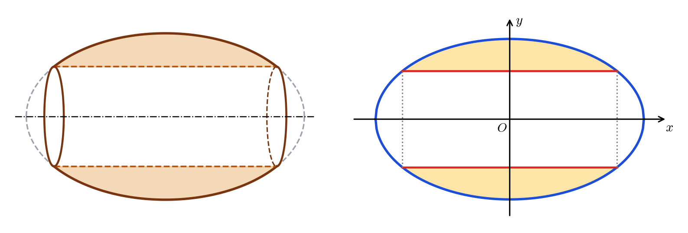
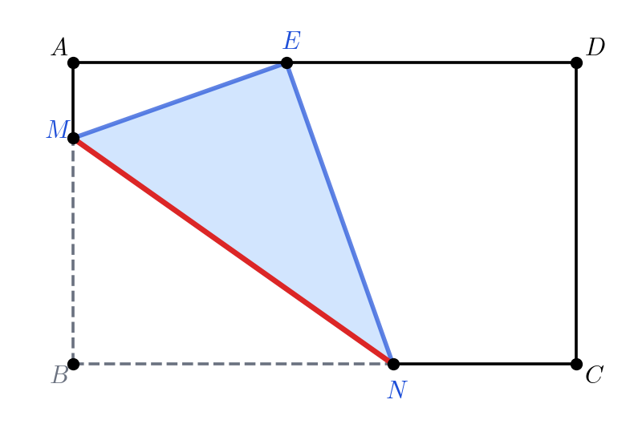
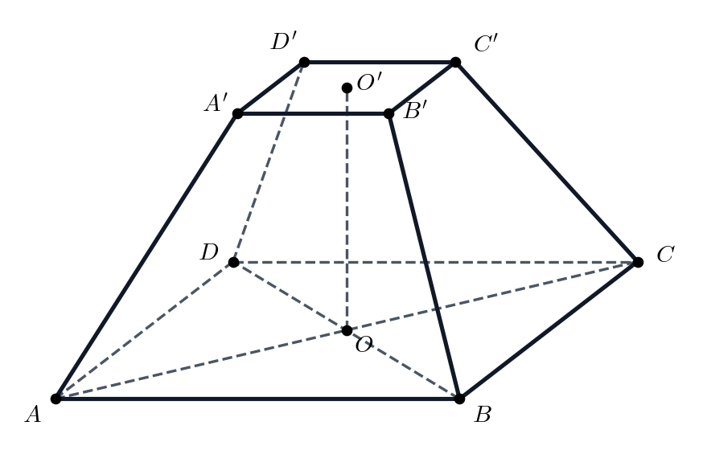
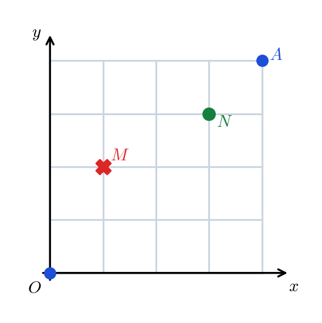
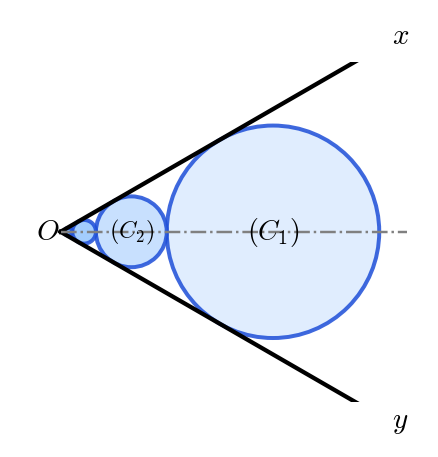

# ĐỀ THI THỬ KÌ THI TNTHPT QUỐC GIA
**Biên soạn:** Trần Trung Quân  
*(Đề thi gồm có 04 trang)*  
**Mã đề: 200**

### KỲ KHẢO SÁT CHẤT LƯỢNG LỚP 12 – ĐỀ THI THỬ KÌ THI TNTHPT QUỐC GIA
**Môn: TOÁN – Lớp 12**  
*Thời gian làm bài: 90 phút, không kể thời gian giao đề*

---
**Họ và tên học sinh:** ................................................................... **Lớp:** .........................

---

## PHẦN I. Thí sinh trả lời từ câu 1 đến câu 12. Mỗi câu hỏi thí sinh chỉ chọn một phương án.
*(Mỗi câu trả lời đúng thí sinh được 0,25 điểm)*

**Câu 1.** Đồ thị hàm số $y = \dfrac{2x^2 - 5x + 1}{x - 1}$ có đường tiệm cận xiên là đường thẳng $\Delta$. Diện tích tam giác tạo bởi đường thẳng $\Delta$ và hai trục tọa độ $Ox, Oy$ bằng  
**A.** $\dfrac{9}{4}$.  
**B.** $\dfrac{9}{2}$.  
**C.** $3$.  
**D.** $\dfrac{3}{2}$.

**Câu 2.** Giá trị nhỏ nhất của hàm số $f(x) = x - 2\ln x$ trên đoạn $[1; e]$ bằng  
**A.** $1$.  
**B.** $e - 2$.  
**C.** $2 - 2\ln 2$.  
**D.** $2 - \ln 2$.

**Câu 3.** Đạo hàm của hàm số $y = \dfrac{e^{2x}}{x + 1}$ (với $x \ne -1$) là  
**A.** $y' = \dfrac{(2x + 3)e^{2x}}{(x + 1)^2}$.  
**B.** $y' = \dfrac{(2x + 1)e^{2x}}{(x + 1)^2}$.  
**C.** $y' = \dfrac{(2x + 1)e^{2x}}{x + 1}$.  
**D.** $y' = \dfrac{x e^{2x}}{(x + 1)^2}$.

**Câu 4.** Cho tam giác $ABC$ có $AB = 5$, $AC = 8$ và $\widehat{BAC} = 60^\circ$. Bán kính đường tròn ngoại tiếp tam giác $ABC$ bằng  
**A.** $\dfrac{7\sqrt{3}}{2}$.  
**B.** $7\sqrt{3}$.  
**C.** $\dfrac{7}{3}$.  
**D.** $\dfrac{7\sqrt{3}}{3}$.

**Câu 5.** Tổng tất cả các nghiệm của phương trình $\sin\left(2x - \dfrac{\pi}{3}\right) = \dfrac{1}{2}$ thuộc đoạn $[0; \pi]$ bằng  
**A.** $\dfrac{\pi}{2}$.  
**B.** $\dfrac{7\pi}{6}$.  
**C.** $\dfrac{5\pi}{6}$.  
**D.** $\dfrac{2\pi}{3}$.

**Câu 6.** Cho cấp số nhân $(u_n)$ có tất cả các số hạng đều dương, thỏa mãn $u_1 + u_2 = 12$ và $u_3 + u_4 = 48$. Giá trị của $u_5$ bằng  
**A.** $64$.  
**B.** $32$.  
**C.** $128$.  
**D.** $48$.

**Câu 7.** Số nghiệm nguyên của bất phương trình $\log_{0,5}(x^2 - 3x + 2) \ge -1$ là  
**A.** $4$.  
**B.** $3$.  
**C.** $1$.  
**D.** $2$.

**Câu 8.** Một bồn hoa công viên có dạng khối chóp cụt tứ giác đều với cạnh đáy lớn bằng $4\text{ m}$, cạnh đáy nhỏ bằng $2\text{ m}$ và chiều cao bằng $3\text{ m}$. Thể tích của khối chóp cụt đó bằng  
**A.** $20\text{ m}^3$.  
**B.** $28\text{ m}^3$.  
**C.** $24\text{ m}^3$.  
**D.** $32\text{ m}^3$.

**Câu 9.** Cho hàm số $f(x) = \begin{cases} 2x + 1 & \text{khi } x \ge 1 \\ 3x^2 & \text{khi } x < 1 \end{cases}$. Giá trị của tích phân $I = \int_0^2 f(x)\,\mathrm{d}x$ bằng  
**A.** $4$.  
**B.** $7$.  
**C.** $5$.  
**D.** $6$.

**Câu 10.** Trong không gian $Oxyz$, một vật thể nằm giữa hai mặt phẳng $x = 0$ và $x = 2$. Biết thiết diện của vật thể bị cắt bởi mặt phẳng vuông góc với trục $Ox$ tại điểm có hoành độ $x$ ($0 \le x \le 2$) là một tam giác đều có cạnh bằng $\sqrt{x^2 + 1}$. Thể tích của vật thể đó bằng  
**A.** $\dfrac{7\sqrt{3}}{6}$.  
**B.** $\dfrac{7\sqrt{3}}{3}$.  
**C.** $\dfrac{14}{3}$.  
**D.** $\dfrac{7\pi\sqrt{3}}{6}$.

**Câu 11.** Thời gian chạy cự li $100\text{ m}$ (đơn vị: giây) của $40$ học sinh lớp $12$ được thống kê trong bảng ghép nhóm sau:

| Thời gian (giây) | $[12; 13)$ | $[13; 14)$ | $[14; 15)$ | $[15; 16)$ | $[16; 17)$ |
| :--- | :---: | :---: | :---: | :---: | :---: |
| **Số học sinh** | $4$ | $10$ | $14$ | $8$ | $4$ |

Khoảng tứ phân vị $\Delta_Q$ của mẫu số liệu ghép nhóm trên bằng  
**A.** $1,45$.  
**B.** $2,25$.  
**C.** $1,85$.  
**D.** $1,65$.

**Câu 12.** Trong không gian với hệ tọa độ $Oxyz$, cho điểm $A(2; -1; 3)$ và mặt cầu $(S): (x - 1)^2 + (y + 1)^2 + (z - 1)^2 = 9$. Mặt phẳng $(P)$ đi qua $A$ và cắt mặt cầu $(S)$ theo giao tuyến là một đường tròn có bán kính nhỏ nhất. Một vectơ pháp tuyến của mặt phẳng $(P)$ là  
**A.** $\vec{n} = (1; -2; 2)$.  
**B.** $\vec{n} = (1; 0; 2)$.  
**C.** $\vec{n} = (3; -2; 4)$.  
**D.** $\vec{n} = (2; -1; 3)$.

---

## PHẦN II. Thí sinh trả lời từ câu 1 đến câu 4. Trong mỗi ý a), b), c), d) ở mỗi câu, thí sinh chọn đúng hoặc sai.
*(Điểm: đúng 1 ý được 0,1 điểm; đúng 2 ý được 0,25 điểm; đúng 3 ý được 0,5 điểm; đúng 4 ý được 1,0 điểm)*

**Câu 1.** Cho hàm số $y = f(x) = \dfrac{x^2 - 3x + 6}{x - 2}$ có đồ thị $(C)$. Xét tính đúng sai của các mệnh đề sau:  
**a)** Hàm số đã cho nghịch biến trên các khoảng $(0; 2)$ và $(2; 4)$.  
**b)** Giá trị cực đại của hàm số lớn hơn giá trị cực tiểu của hàm số.  
**c)** Đồ thị $(C)$ nhận điểm $I(2; 1)$ làm tâm đối xứng và khoảng cách giữa hai điểm cực trị của $(C)$ bằng $4\sqrt{5}$.  
**d)** Có đúng $7$ giá trị nguyên của tham số $m$ để đường thẳng $y = m$ không có điểm chung với đồ thị $(C)$.

**Câu 2.** Trong khoảng thời gian $12\text{ giờ}$ ban ngày (tính bằng $t$ giờ, $0 \le t \le 12$), một hệ thống điện mặt trời áp mái của một hộ gia đình phát điện với công suất $P_{\text{phát}}(t) = -\dfrac{1}{4}t^2 + 3t\text{ (kW)}$, trong khi công suất tiêu thụ điện của gia đình là $P_{\text{tiêu}}(t) = 0,5t + 4\text{ (kW)}$. Biết rằng điện năng (kWh) là tích phân của công suất theo thời gian. Xét tính đúng sai của các mệnh đề sau:  
**a)** Tổng lượng điện năng mà hệ thống pin mặt trời phát ra trong $12\text{ giờ}$ bằng $72\text{ kWh}$.  
**b)** Trong khoảng thời gian từ $t = 2\text{ giờ}$ đến $t = 8\text{ giờ}$, lượng điện dư thu được từ hệ thống bằng $9\text{ kWh}$.  
**c)** Công suất phát điện vượt công suất tiêu thụ một lượng lớn nhất tại thời điểm $t = 6\text{ giờ}$ với độ chênh lệch bằng $2\text{ kW}$.  
**d)** Nếu toàn bộ phần điện dư thu được được lưu trữ vào pin dự phòng với hiệu suất $100\%$ để dùng bù cho các giờ thiếu điện trong khoảng $12\text{ giờ}$ đó, lượng điện gia đình còn phải mua thêm từ lưới điện bằng $12\text{ kWh}$.

**Câu 3.** Một bệnh viện ứng dụng hệ thống trí tuệ nhân tạo (AI) để hỗ trợ sàng lọc một loại bệnh phổi qua ảnh X-quang. Theo thống kê trên nhóm người đến khám sàng lọc, tỉ lệ người thực sự mắc bệnh là $2\%$. Nếu một người thực sự mắc bệnh, mô hình AI chẩn đoán cho kết quả dương tính với xác suất $95\%$. Nếu một người không mắc bệnh, mô hình AI vẫn có thể báo nhầm kết quả dương tính với xác suất $5\%$. Chọn ngẫu nhiên một người đến khám để hệ thống AI sàng lọc. Xét tính đúng sai của các mệnh đề sau:  
**a)** Xác suất để người được chọn vừa mắc bệnh vừa nhận kết quả dương tính từ AI bằng $0,019$.  
**b)** Xác suất để mô hình AI trả về kết quả dương tính đối với một người đến khám bất kì bằng $0,05$.  
**c)** Nếu hệ thống AI trả về kết quả dương tính, xác suất để người đó thực sự mắc bệnh nhỏ hơn $28\%$.  
**d)** Nếu hệ thống AI trả về kết quả âm tính, xác suất để người đó thực sự mắc bệnh lớn hơn $0,2\%$.

**Câu 4.** Trong không gian với hệ tọa độ $Oxyz$ (đơn vị đo trên các trục là mét), một phòng thí nghiệm quang học đặt một tấm gương phẳng lớn nằm trên mặt phẳng $(P): x + 2y - 2z - 5 = 0$. Một nguồn phát tia laser đặt tại điểm $A(2; 4; -2)$ chiếu một tia sáng tới gặp mặt gương $(P)$ tại điểm $M(3; 3; 2)$ rồi phản xạ theo quy luật phản xạ ánh sáng (tia tới và tia phản xạ nằm trong cùng mặt phẳng chứa pháp tuyến tại $M$, góc tới bằng góc phản xạ). Xét tính đúng sai của các mệnh đề sau:  
**a)** Khoảng cách từ nguồn phát $A$ đến mặt gương $(P)$ bằng $4\text{ m}$ và tọa độ điểm đối xứng của $A$ qua $(P)$ là $A'(0; 0; 2)$.  
**b)** Góc tạo bởi tia sáng tới $AM$ và mặt phẳng gương $(P)$ bằng $45^\circ$.  
**c)** Tia sáng phản xạ đi qua điểm $M$ có một vectơ chỉ phương là $\vec{u} = (1; -1; 0)$.  
**d)** Đặt một cảm biến thu sáng tại điểm $B(6; 6; 2)$. Nếu tia sáng đi từ $A$ tới chạm mặt gương $(P)$ tại một điểm $N$ thay đổi trên $(P)$ rồi truyền thẳng tới $B$ thì tổng quãng đường truyền $AN + NB$ ngắn nhất bằng $6\sqrt{2}\text{ m}$.

---

## PHẦN III. Thí sinh trả lời từ câu 1 đến câu 6.
*(Mỗi câu trả lời đúng thí sinh được 0,5 điểm)*

**Câu 1.** Một nghệ nhân chế tác một hạt vòng gỗ mỹ nghệ bằng cách tiện một khối gỗ đặc có hình dạng là khối tròn xoay thu được khi quay hình elip $(E)$ (có độ dài trục lớn bằng $10\text{ cm}$, độ dài trục nhỏ bằng $6\text{ cm}$) quanh trục lớn của nó. Sau đó, nghệ nhân khoan xuyên tâm dọc theo trục lớn một lỗ hình trụ có bán kính đáy $r = 1,8\text{ cm}$ (toàn bộ phần gỗ nằm bên trong mặt trụ bị loại bỏ, phần mặt cắt trên hệ trục $Oxy$ được tô đậm như hình vẽ bên dưới). Thể tích phần gỗ còn lại của hạt vòng bằng bao nhiêu $\text{cm}^3$ (làm tròn kết quả đến hàng phần mười)?

**Câu 2.** Cho một tờ giấy hình chữ nhật $ABCD$ có chiều rộng $AB = 12\text{ cm}$ và chiều dài $BC = 20\text{ cm}$. Người ta gấp góc $B$ của tờ giấy sao cho đỉnh $B$ chạm tới một điểm $E$ nằm trên cạnh đối diện $AD$, tạo thành nếp gấp là đoạn thẳng $MN$ (với $M$ nằm trên đoạn $AB$, $N$ nằm trên đoạn $BC$, tham khảo hình vẽ). Độ dài ngắn nhất của nếp gấp $MN$ bằng bao nhiêu centimét (làm tròn kết quả đến hàng phần mười)?

**Câu 3.** Phần bệ đỡ của một tháp quan sát được thiết kế có dạng hình chóp cụt tứ giác đều $ABCD.A'B'C'D'$ với cạnh đáy dưới $AB = 8\text{ m}$, cạnh đáy trên $A'B' = 2\text{ m}$ và chiều cao $OO' = 4\text{ m}$ (tham khảo hình vẽ). Tính số đo của góc nhị diện $[A, BB', C]$ tạo bởi hai mặt bên kề nhau (đơn vị: độ, làm tròn kết quả đến hàng đơn vị).

**Câu 4.** Trong không gian với hệ tọa độ $Oxyz$ (đơn vị đo trên các trục là mét), một phòng thí nghiệm có sàn nhà nằm trên mặt phẳng $(Oxy): z = 0$ và một bức tường kính phẳng nằm trên mặt phẳng $(P): x + y - 4 = 0$. Một thiết bị bay không người lái (drone) xuất phát từ điểm $A(1; 1; 2)$, bay thẳng tới chạm nhẹ vào bức tường kính $(P)$ tại điểm $M$, sau đó bay thẳng tới chạm sàn nhà $(Oxy)$ tại điểm $N$ rồi bay thẳng về trạm sạc $B(1; -3; 1)$. Tổng quãng đường bay ngắn nhất của drone bằng bao nhiêu mét?

**Câu 5.** Trên mặt phẳng tọa độ $Oxy$, một robot tự hành xuất phát từ điểm $O(0; 0)$ để di chuyển đến đích $A(4; 4)$ theo các cạnh của lưới ô vuông đơn vị (tham khảo hình vẽ). Ở mỗi bước, robot chỉ được phép đi sang phải $1$ đơn vị hoặc đi lên trên $1$ đơn vị, và tất cả các đường đi ngắn nhất từ $O$ đến $A$ đều có khả năng được chọn như nhau. Biết rằng robot đã tránh được điểm chướng ngại vật $M(1; 2)$ (không đi qua $M$), tính xác suất để robot đi qua trạm tiếp nhiên liệu $N(3; 3)$.

**Câu 6.** Trong góc nhọn $\widehat{xOy} = 60^\circ$, người ta vẽ vô hạn các hình tròn $(C_1), (C_2), (C_3), \dots$ sao cho mỗi hình tròn đều tiếp xúc với hai tia $Ox, Oy$; hình tròn lớn nhất $(C_1)$ có bán kính $R_1 = 4\text{ cm}$ và mỗi hình tròn $(C_{n+1})$ có bán kính nhỏ hơn $(C_n)$ đồng thời tiếp xúc ngoài với $(C_n)$ với mọi $n \ge 1$ (tham khảo hình vẽ). Tổng diện tích của tất cả các hình tròn đó bằng bao nhiêu $\text{cm}^2$ (làm tròn kết quả đến hàng phần mười)?

---
**---------- HẾT ----------**  
*Thí sinh không được sử dụng tài liệu. Cán bộ coi thi không giải thích gì thêm.*
