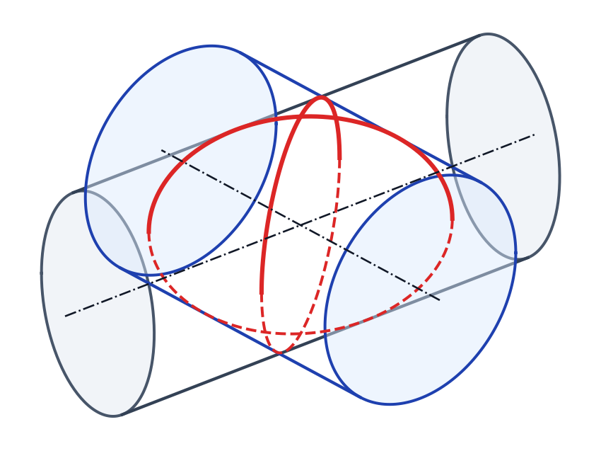
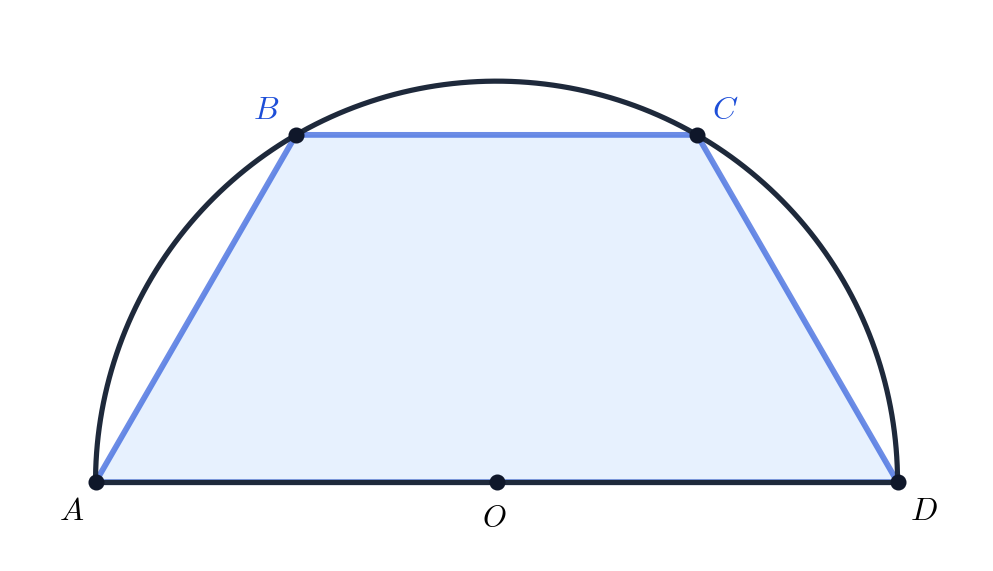

# ĐỀ THI THỬ KÌ THI TNTHPT QUỐC GIA
**Biên soạn:** Trần Trung Quân  
*(Đề thi gồm có 04 trang)*  
**Mã đề: 201**

### KỲ KHẢO SÁT CHẤT LƯỢNG LỚP 12 – ĐỀ THI THỬ KÌ THI TNTHPT QUỐC GIA
**Môn: TOÁN – Lớp 12**  
*Thời gian làm bài: 90 phút, không kể thời gian giao đề*

---
**Họ và tên học sinh:** ................................................................... **Lớp:** .........................

---

## PHẦN I. Thí sinh trả lời từ câu 1 đến câu 12. Mỗi câu hỏi thí sinh chỉ chọn một phương án.
*(Mỗi câu trả lời đúng thí sinh được 0,25 điểm)*

**Câu 1.** Đường tiệm cận xiên của đồ thị hàm số $y = \dfrac{x^2 - 4x + 5}{x - 2}$ có phương trình là  
**A.** $y = x + 2$.  
**B.** $y = x - 4$.  
**C.** $y = x - 2$.  
**D.** $y = 2x - 2$.

**Câu 2.** Biết $F(x)$ là một nguyên hàm của hàm số $f(x) = \sin 2x + e^{3x}$ trên $\mathbb{R}$ thỏa mãn $F(0) = \dfrac{5}{6}$. Giá trị của $F\left(\dfrac{\pi}{4}\right)$ bằng  
**A.** $\dfrac{1}{3}e^{\frac{3\pi}{4}} + 1$.  
**B.** $\dfrac{1}{3}e^{\frac{3\pi}{4}} + \dfrac{1}{2}$.  
**C.** $e^{\frac{3\pi}{4}} + 1$.  
**D.** $\dfrac{1}{3}e^{\frac{3\pi}{4}} - \dfrac{1}{6}$.

**Câu 3.** Đạo hàm của hàm số $y = \log_2(x^2 + 2x + 5)$ trên $\mathbb{R}$ là  
**A.** $y' = \dfrac{1}{(x^2 + 2x + 5)\ln 2}$.  
**B.** $y' = \dfrac{(2x + 2)\ln 2}{x^2 + 2x + 5}$.  
**C.** $y' = \dfrac{2x + 2}{x^2 + 2x + 5}$.  
**D.** $y' = \dfrac{2x + 2}{(x^2 + 2x + 5)\ln 2}$.

**Câu 4.** Trong mặt phẳng tọa độ $Oxy$, đường tròn tâm $I(2; -3)$ và đi qua điểm $A(-1; 1)$ có phương trình là  
**A.** $(x + 2)^2 + (y - 3)^2 = 25$.  
**B.** $(x - 2)^2 + (y + 3)^2 = 25$.  
**C.** $(x - 2)^2 + (y + 3)^2 = 5$.  
**D.** $(x + 2)^2 + (y - 3)^2 = 5$.

**Câu 5.** Một khán phòng được thiết kế gồm $20$ hàng ghế, trong đó hàng đầu tiên có $18$ ghế và mỗi hàng ghế phía sau có nhiều hơn hàng ngay trước nó $3$ ghế. Tổng số ghế có trong khán phòng đó bằng  
**A.** $930$.  
**B.** $900$.  
**C.** $960$.  
**D.** $870$.

**Câu 6.** Cho hình chóp $S.ABC$ có đáy $ABC$ là tam giác đều cạnh $a$, cạnh bên $SA \perp (ABC)$ và $SA = a\sqrt{3}$. Góc giữa đường thẳng $SB$ và mặt phẳng $(ABC)$ bằng  
**A.** $30^\circ$.  
**B.** $45^\circ$.  
**C.** $60^\circ$.  
**D.** $90^\circ$.

**Câu 7.** Trong không gian với hệ tọa độ $Oxyz$, cho đường thẳng $d: \dfrac{x - 1}{2} = \dfrac{y + 2}{-1} = \dfrac{z}{2}$ và mặt phẳng $(P): 2x + y - 2z + 5 = 0$. Côsin của góc tạo bởi đường thẳng $d$ và mặt phẳng $(P)$ bằng  
**A.** $\dfrac{1}{9}$.  
**B.** $\dfrac{4\sqrt{5}}{9}$.  
**C.** $\dfrac{2\sqrt{5}}{9}$.  
**D.** $\dfrac{8}{9}$.

**Câu 8.** Tập nghiệm của bất phương trình $3^{x^2 - 2x} < 27$ là khoảng $(a; b)$. Giá trị của biểu thức $a + 2b$ bằng  
**A.** $1$.  
**B.** $4$.  
**C.** $3$.  
**D.** $5$.

**Câu 9.** Diện tích hình phẳng giới hạn bởi các đường $y = e^x$, $y = e^{-x}$, $x = 0$ và $x = 1$ bằng  
**A.** $e + e^{-1} - 2$.  
**B.** $e - e^{-1} - 2$.  
**C.** $e + e^{-1}$.  
**D.** $e - e^{-1}$.

**Câu 10.** Kết quả đo thời gian hoàn thành một bài kiểm tra trực tuyến (đơn vị: phút) của $20$ học sinh được thống kê trong bảng tần số ghép nhóm sau:

| Thời gian (phút) | $[2; 4)$ | $[4; 6)$ | $[6; 8)$ | $[8; 10)$ |
| :--- | :---: | :---: | :---: | :---: |
| **Số học sinh** | $4$ | $6$ | $8$ | $2$ |

Phương sai $s^2$ của mẫu số liệu ghép nhóm trên bằng  
**A.** $5,8$.  
**B.** $3,16$.  
**C.** $4,24$.  
**D.** $3,36$.

**Câu 11.** Cho hai biến cố $A$ và $B$ thỏa mãn $P(A) = 0,6$, $P(B) = 0,5$ và $P(B|A) = 0,3$. Giá trị của $P(A|B)$ bằng  
**A.** $0,18$.  
**B.** $0,25$.  
**C.** $0,36$.  
**D.** $0,15$.

**Câu 12.** Cho dãy số $(u_n)$ biết $u_1 = 2$ và $u_{n+1} = 3u_n - 1$ với mọi $n \ge 1$. Giá trị của $u_3$ bằng  
**A.** $5$.  
**B.** $14$.  
**C.** $41$.  
**D.** $17$.

---

## PHẦN II. Thí sinh trả lời từ câu 1 đến câu 4. Trong mỗi ý a), b), c), d) ở mỗi câu, thí sinh chọn đúng hoặc sai.
*(Điểm: đúng 1 ý được 0,1 điểm; đúng 2 ý được 0,25 điểm; đúng 3 ý được 0,5 điểm; đúng 4 ý được 1,0 điểm)*

**Câu 1.** Cho hàm số $y = f(x) = x^3 - 3x^2 - 9x + 11$ có đồ thị $(C)$. Xét tính đúng sai của các mệnh đề sau:  
**a)** Hàm số đã cho đồng biến trên khoảng $(-\infty; -1)$ và nghịch biến trên khoảng $(-1; 3)$.  
**b)** Giá trị lớn nhất của hàm số $f(x)$ trên đoạn $[0; 4]$ bằng $11$.  
**c)** Đường thẳng đi qua hai điểm cực trị của đồ thị $(C)$ có phương trình là $y = -8x - 8$.  
**d)** Có đúng $26$ giá trị nguyên của tham số $m$ để phương trình $f(|x|) = m$ có $4$ nghiệm thực phân biệt.

**Câu 2.** Một đoàn tàu cao tốc thử nghiệm rời ga từ trạng thái đứng yên ($v(0) = 0$) và chuyển động thẳng trong $20\text{ giây}$ với vận tốc biến thiên liên tục theo hai giai đoạn: trong $10\text{ giây}$ đầu tiên ($0 \le t \le 10$), gia tốc của tàu là $a(t) = 0,6t\text{ (m/s}^2)$; trong $10\text{ giây}$ tiếp theo ($10 < t \le 20$), tàu chuyển động chậm dần đều rồi dừng hẳn tại thời điểm $t = 20\text{ s}$. Xét tính đúng sai của các mệnh đề sau:  
**a)** Vận tốc lớn nhất của đoàn tàu trong suốt $20\text{ giây}$ thử nghiệm đạt được tại $t = 10\text{ s}$ và bằng $120\text{ km/h}$.  
**b)** Quãng đường đoàn tàu đi được trong $10\text{ giây}$ đầu tiên bằng $100\text{ m}$.  
**c)** Gia tốc của đoàn tàu trong khoảng thời gian từ $t = 10\text{ s}$ đến $t = 20\text{ s}$ bằng $-3\text{ m/s}^2$.  
**d)** Tổng quãng đường đoàn tàu đi được trong $20\text{ giây}$ thử nghiệm lớn hơn $260\text{ m}$.

**Câu 3.** Một nhà máy sản xuất chip điện tử có hai dây chuyền I và II. Dây chuyền I sản xuất $60\%$ tổng sản lượng với tỉ lệ chip đạt chuẩn là $96\%$. Dây chuyền II sản xuất $40\%$ tổng sản lượng với tỉ lệ chip đạt chuẩn là $91\%$. Toàn bộ chip từ hai dây chuyền được đưa chung vào một kho lưu trữ lớn. Chọn ngẫu nhiên một con chip từ kho để kiểm tra chất lượng. Xét tính đúng sai của các mệnh đề sau:  
**a)** Tỉ lệ chip bị lỗi của toàn bộ nhà máy bằng $6\%$.  
**b)** Xác suất để con chip được chọn vừa đạt chuẩn vừa do dây chuyền II sản xuất bằng $0,36$.  
**c)** Biết rằng con chip được chọn bị lỗi, xác suất để con chip đó do dây chuyền I sản xuất lớn hơn xác suất nó do dây chuyền II sản xuất.  
**d)** Nếu chọn ngẫu nhiên độc lập $2$ con chip từ kho (coi số lượng chip trong kho rất lớn), xác suất để có đúng $1$ con chip đạt chuẩn lớn hơn $11\%$.

**Câu 4.** Trong không gian với hệ tọa độ $Oxyz$ (đơn vị đo trên mỗi trục là kilômét), mặt đất được xem là mặt phẳng $(Oxy): z = 0$. Một trạm radar kiểm soát không lưu đặt tại vị trí $I(2; 1; 9)$ có phạm vi quét tối đa trong hình cầu $(S)$ tâm $I$, bán kính $R = 15\text{ km}$. Tại thời điểm $t = 0\text{ (s)}$, một máy bay bắt đầu bay thẳng đều từ điểm $A(-16; -8; 9)$ với vectơ vận tốc không đổi $\vec{v} = (0,2;\; 0,2;\; 0,1)\text{ (km/s)}$. Xét tính đúng sai của các mệnh đề sau:  
**a)** Phương trình mặt cầu $(S)$ giới hạn vùng phủ sóng của radar là $(x - 2)^2 + (y - 1)^2 + (z - 9)^2 = 15$.  
**b)** Vùng phủ sóng của radar cắt mặt đất $(Oxy)$ theo giao tuyến là một hình tròn có diện tích bằng $120\pi\text{ km}^2$.  
**c)** Khoảng cách ngắn nhất từ trạm radar $I$ đến đường bay của máy bay bằng $9\text{ km}$.  
**d)** Tổng thời gian máy bay nằm trong phạm vi phát hiện của radar bằng $80\text{ giây}$.

---

## PHẦN III. Thí sinh trả lời từ câu 1 đến câu 6.
*(Mỗi câu trả lời đúng thí sinh được 0,5 điểm)*

**Câu 1.** Hai ống trụ tròn xoay đặc giống hệt nhau có cùng bán kính đáy $R = 3\text{ cm}$ được đặt sao cho hai trục đối xứng của chúng cắt và vuông góc với nhau tại tâm $O$ (tham khảo hình vẽ bên dưới). Thể tích phần chung của hai khối trụ đó bằng bao nhiêu $\text{cm}^3$?

**Câu 2.** Một nhà thiết kế chế tạo khung đèn trang trí có dạng hình thang cân $ABCD$ nội tiếp trong nửa đường tròn tâm $O$, đường kính $AD = 12\text{ dm}$ với hai đỉnh $B, C$ nằm trên nửa đường tròn (tham khảo hình vẽ). Diện tích lớn nhất của khung hình thang $ABCD$ bằng bao nhiêu $\text{dm}^2$ (làm tròn kết quả đến hàng phần mười)?

**Câu 3.** Một giàn giáo khung thép có dạng hình lăng trụ đứng $ABC.A'B'C'$ với đáy $ABC$ là tam giác đều cạnh $AB = 6\text{ m}$ và chiều cao $AA' = 8\text{ m}$. Khoảng cách giữa hai thanh giằng chéo nhau $AB'$ và $BC'$ bằng bao nhiêu mét (làm tròn kết quả đến hàng phần trăm)?

**Câu 4.** Trong không gian với hệ tọa độ $Oxyz$ (đơn vị trên mỗi trục là mét), tại thời điểm $t = 0\text{ (s)}$, hai thiết bị bay không người lái (UAV) cùng xuất phát chuyển động thẳng đều với vận tốc không đổi: UAV thứ nhất xuất phát từ điểm $A(-4; -2; 7)$ với vectơ vận tốc $\vec{v}_1 = (3; 2; 0)\text{ m/s}$, UAV thứ hai xuất phát từ điểm $B(4; 5; 5)$ với vectơ vận tốc $\vec{v}_2 = (1; 1; 2)\text{ m/s}$. Khoảng cách ngắn nhất giữa hai UAV trong quá trình bay (với $t \ge 0$) bằng bao nhiêu mét?

**Câu 5.** Cho đa giác đều $12$ đỉnh nội tiếp trong một đường tròn. Chọn ngẫu nhiên đồng thời $4$ đỉnh trong số $12$ đỉnh của đa giác để tạo thành một tứ giác lồi. Biết rằng tứ giác tạo thành có hai đường chéo vuông góc với nhau, tính xác suất để tứ giác đó là một hình vuông.

**Câu 6.** Có hai hộp chứa các viên bi cùng kích thước và khối lượng: hộp I chứa $5$ viên bi đỏ và $4$ viên bi xanh; hộp II chứa $6$ viên bi đỏ và $3$ viên bi xanh (tham khảo hình vẽ). Lấy ngẫu nhiên đồng thời $2$ viên bi từ hộp I bỏ sang hộp II, sau đó lấy ngẫu nhiên đồng thời $2$ viên bi từ hộp II. Biết rằng $2$ viên bi lấy ra từ hộp II có cùng màu, tính xác suất để $2$ viên bi chuyển từ hộp I sang hộp II trước đó đều là bi đỏ.

---
**---------- HẾT ----------**  
*Thí sinh không được sử dụng tài liệu. Cán bộ coi thi không giải thích gì thêm.*
