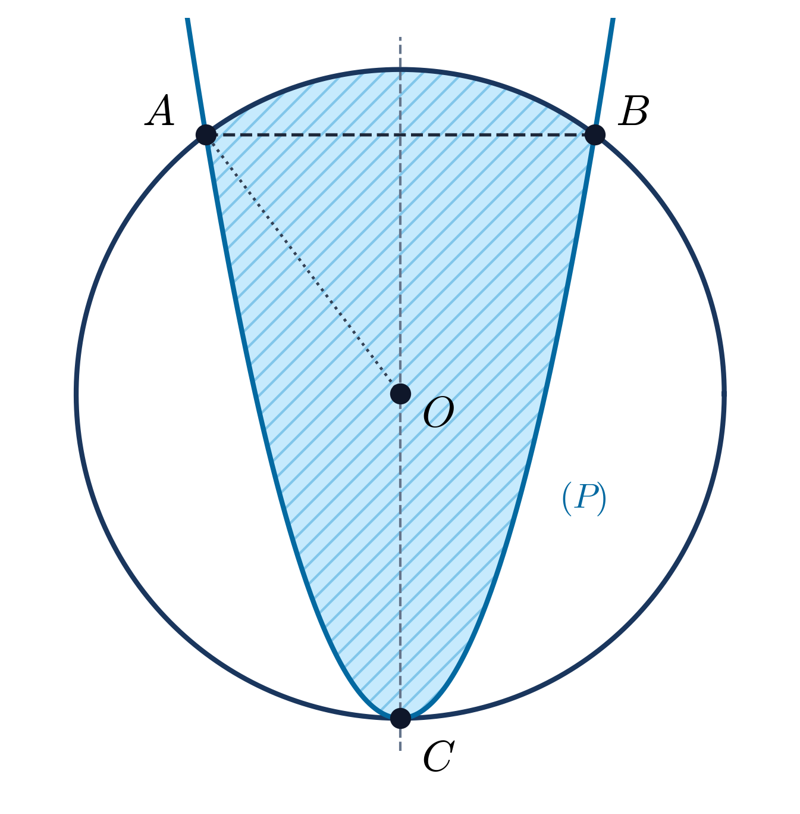
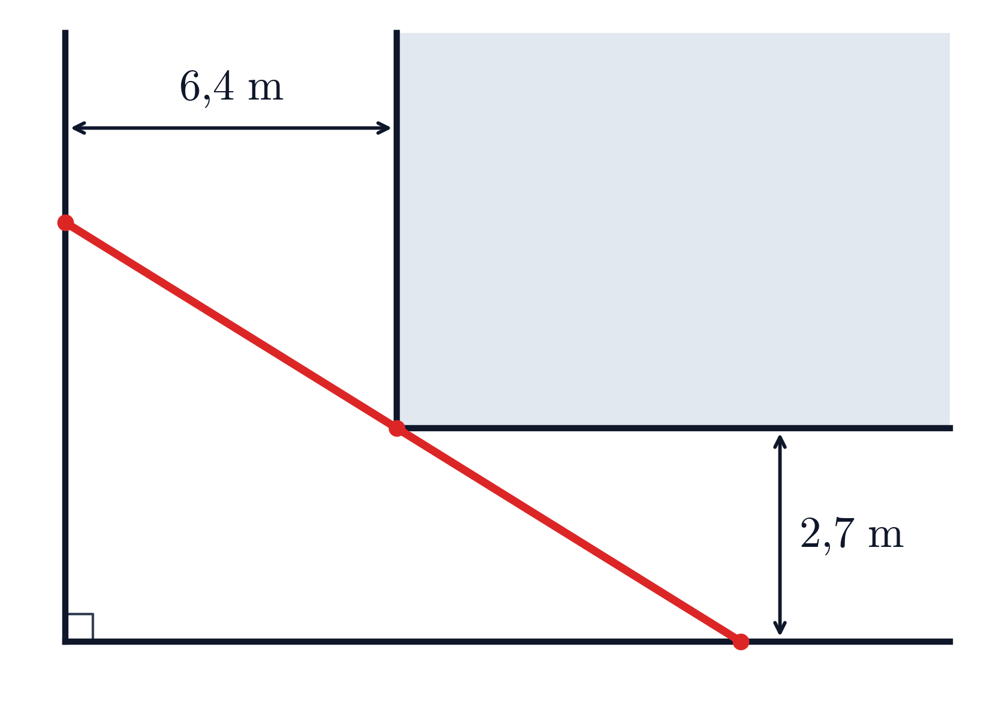

# ĐỀ THI THỬ KÌ THI TNTHPT QUỐC GIA – MÔN TOÁN (MÃ ĐỀ 202)
**Kỳ khảo sát chất lượng lớp 12 – Biên soạn: Trần Trung Quân**  
*(Đề thi gồm có 04 trang – Thời gian làm bài: 90 phút, không kể thời gian giao đề)*

---

## PHẦN I. Câu trắc nghiệm nhiều phương án lựa chọn
*Thí sinh trả lời từ câu 1 đến câu 12. Mỗi câu hỏi thí sinh chỉ chọn một phương án.*

**Câu 1.** Hệ số của $x^2$ trong khai triển nhị thức Newton $(2x - 1)^4$ bằng  
A. $6$.  
B. $24$.  
C. $-24$.  
D. $12$.

**Câu 2.** Cho $\displaystyle\int_1^4 f(x)\,dx = 6$ và $\displaystyle\int_1^4 g(x)\,dx = -2$. Giá trị của $\displaystyle\int_1^4 \big[2f(x) - 3g(x)\big]\,dx$ bằng  
A. $6$.  
B. $14$.  
C. $10$.  
D. $18$.

**Câu 3.** Đạo hàm của hàm số $y = 5^{2x - 1}$ là  
A. $y' = 2 \cdot 5^{2x - 1} \ln 5$.  
B. $y' = 5^{2x - 1} \ln 5$.  
C. $y' = \dfrac{2 \cdot 5^{2x - 1}}{\ln 5}$.  
D. $y' = (2x - 1)5^{2x - 2}$.

**Câu 4.** Trong không gian $Oxyz$, góc giữa hai vectơ $\vec{u} = (1; 1; 0)$ và $\vec{v} = (0; 1; 1)$ bằng  
A. $30^\circ$.  
B. $45^\circ$.  
C. $60^\circ$.  
D. $90^\circ$.

**Câu 5.** Với $a, b$ là các số thực dương tùy ý, $a \ne 1$ và $\log_a b = 4$. Giá trị của biểu thức $P = \log_a(a^3 b^2)$ bằng  
A. $11$.  
B. $24$.  
C. $14$.  
D. $9$.

**Câu 6.** Giá trị nhỏ nhất của hàm số $y = x + \dfrac{4}{x}$ trên đoạn $[1; 3]$ bằng  
A. $\dfrac{13}{3}$.  
B. $5$.  
C. $4$.  
D. $2$.

**Câu 7.** Phương trình $\cos 2x = \dfrac{\sqrt{2}}{2}$ có họ nghiệm là  
A. $x = \pm \dfrac{\pi}{4} + k\pi \ (k \in \mathbb{Z})$.  
B. $x = \pm \dfrac{\pi}{8} + k\pi \ (k \in \mathbb{Z})$.  
C. $x = \pm \dfrac{\pi}{8} + k2\pi \ (k \in \mathbb{Z})$.  
D. $x = \dfrac{\pi}{8} + k\pi \ (k \in \mathbb{Z})$.

**Câu 8.** Cho hình lăng trụ đứng $ABC.A'B'C'$ có đáy $ABC$ là tam giác vuông cân tại $B$ với $AB = 2a$ và cạnh bên $AA' = 3a$. Thể tích của khối lăng trụ đã cho bằng  
A. $2a^3$.  
B. $4a^3$.  
C. $12a^3$.  
D. $6a^3$.

**Câu 9.** Trong không gian $Oxyz$, mặt phẳng đi qua điểm $M(1; -2; 3)$ và song song với mặt phẳng $(Q): 2x - 3y + z - 5 = 0$ có phương trình là  
A. $2x - 3y + z - 11 = 0$.  
B. $2x - 3y + z + 11 = 0$.  
C. $2x - 3y + z - 5 = 0$.  
D. $x - 2y + 3z - 11 = 0$.

**Câu 10.** Kết quả đo chiều cao (đơn vị: cm) của $50$ cây giống trong vườn ươm được thống kê trong bảng tần số ghép nhóm sau:

| Chiều cao (cm) | $[150; 155)$ | $[155; 160)$ | $[160; 165)$ | $[165; 170)$ | $[170; 175)$ |
|:---|:---:|:---:|:---:|:---:|:---:|
| **Số cây** | $4$ | $10$ | $16$ | $12$ | $8$ |

Mốt $M_o$ của mẫu số liệu ghép nhóm trên bằng  
A. $162$.  
B. $162,5$.  
C. $163$.  
D. $164$.

**Câu 11.** Cho hai biến cố $A$ và $B$ thỏa mãn $P(A) = 0,5$, $P(B) = 0,4$ và $P(A|B) = 0,3$. Giá trị của $P(A \cup B)$ bằng  
A. $0,9$.  
B. $0,78$.  
C. $0,12$.  
D. $0,75$.

**Câu 12.** Cho dãy số $(u_n)$ có số hạng tổng quát $u_n = \dfrac{3n - 2}{n + 1}$ ($n \in \mathbb{N}^*$). Số $\dfrac{19}{8}$ là số hạng thứ bao nhiêu của dãy số đã cho?  
A. Thứ $5$.  
B. Thứ $6$.  
C. Thứ $8$.  
D. Thứ $7$.

---

## PHẦN II. Câu trắc nghiệm đúng sai
*Thí sinh trả lời từ câu 1 đến câu 4. Trong mỗi ý a), b), c), d) ở mỗi câu, thí sinh chọn đúng hoặc sai.*

**Câu 1.** Cho hàm số $f(x) = (x^2 - 3x + 1)e^x$.  
a) Đạo hàm của hàm số đã cho là $f'(x) = (x^2 - x - 2)e^x$.  
b) Hàm số đạt cực tiểu tại $x = -1$ và đạt cực đại tại $x = 2$.  
c) Giá trị lớn nhất của hàm số trên đoạn $[0; 3]$ bằng $e^3$.  
d) Phương trình $f(x) = 0$ vô nghiệm trên $\mathbb{R}$.

**Câu 2.** Một bể chứa ban đầu đang có $100\text{ m}^3$ nước sạch. Từ thời điểm $t = 0$ phút đến $t = 30$ phút, người ta mở đồng thời vòi bơm nước vào bể với lưu lượng $v_1(t) = 0,3t + 8$ ($\text{m}^3/\text{phút}$) và mở van xả nước phục vụ tưới tiêu với lưu lượng $v_2(t) = 0,03t^2 + 2$ ($\text{m}^3/\text{phút}$), với $0 \le t \le 30$. Gọi $V(t)$ là lượng nước có trong bể tại thời điểm $t$ phút.  
a) Tổng lượng nước bơm vào bể trong $10$ phút đầu tiên bằng $105\text{ m}^3$.  
b) Lượng nước trong bể tăng liên tục trong $20$ phút đầu tiên.  
c) Lượng nước lớn nhất có trong bể trong khoảng thời gian $30$ phút trên bằng $200\text{ m}^3$.  
d) Tại thời điểm $t = 30$ phút, lượng nước còn lại trong bể nhiều hơn $150\text{ m}^3$.

**Câu 3.** Có hai hộp đựng các viên bi có cùng kích thước và khối lượng: Hộp I chứa $6$ viên bi trắng và $5$ viên bi đen; Hộp II chứa $3$ viên bi trắng và $4$ viên bi đen. Thực hiện liên tiếp hai bước ngẫu nhiên sau: ở bước 1, lấy ngẫu nhiên đồng thời $2$ viên bi từ Hộp I bỏ sang Hộp II; ở bước 2, trộn đều rồi lấy ngẫu nhiên đồng thời $2$ viên bi từ Hộp II ra ngoài.  
a) Xác suất để $2$ viên bi lấy ra từ Hộp I ở bước 1 có cùng màu bằng $\dfrac{5}{11}$.  
b) Biết rằng ở bước 1 đã chuyển sang Hộp II hai viên bi cùng màu trắng, xác suất để $2$ viên bi lấy ra từ Hộp II ở bước 2 đều có màu trắng bằng $\dfrac{1}{3}$.  
c) Xác suất để $2$ viên bi lấy ra từ Hộp II ở bước 2 có cùng màu bằng $\dfrac{6}{11}$.  
d) Giả sử kết quả ở bước 2 lấy được $2$ viên bi đều màu trắng; khi đó xác suất để ở bước 1 đã chuyển sang Hộp II đúng $1$ viên bi trắng và $1$ viên bi đen bằng $\dfrac{1}{2}$.

**Câu 4.** Trong không gian $Oxyz$ (đơn vị trên mỗi trục là mét), mặt đất được mô hình hóa bởi mặt phẳng $(Oxy)$ với trục $Oz$ hướng thẳng đứng lên trên. Một nhà kho có phần mái dốc phẳng nằm trong mặt phẳng $(\alpha): x + 2y + 2z - 48 = 0$. Trên đỉnh một cột thu phát thẳng đứng, người ta đặt thiết bị cảm biến tại điểm $S(10; 9; 19)$.  
a) Góc tạo bởi mặt phẳng mái $(\alpha)$ và mặt đất $(Oxy)$ nhỏ hơn $45^\circ$.  
b) Khoảng cách từ vị trí đặt cảm biến $S$ đến mặt phẳng mái $(\alpha)$ bằng $6\text{ m}$.  
c) Điểm trên mặt phẳng mái $(\alpha)$ gần cảm biến $S$ nhất có tọa độ là $K(8; 5; 15)$.  
d) Dựng một thanh giằng thẳng nối từ $S$ tới điểm $A(4; 9; 13)$ thuộc mặt mái $(\alpha)$; khi đó góc tạo bởi thanh giằng $SA$ và mặt mái $(\alpha)$ bằng $60^\circ$.

---

## PHẦN III. Câu trắc nghiệm trả lời ngắn
*Thí sinh trả lời từ câu 1 đến câu 6.*

**Câu 1.** Một chi tiết trang trí hình tròn tâm $O$, bán kính $R = 5\text{ dm}$. Người ta thiết kế phần tô màu bên trong hình tròn được giới hạn bởi cung nhỏ $\widehat{AB}$ có độ dài dây cung $AB = 6\text{ dm}$ và một đường parabol $(P)$ nhận điểm thấp nhất $C$ của đường tròn làm đỉnh, đi qua hai điểm $A, B$ (như hình vẽ, trục đối xứng của $(P)$ là đường kính $OC$ vuông góc với $AB$, trong đó $A$ và $B$ nằm về nửa đường tròn đối diện với $C$ qua $O$). Tính diện tích của phần tô màu (đơn vị: $\text{dm}^2$, kết quả làm tròn đến hàng phần chục).

**Câu 2.** Một hành lang chữ L trong nhà xưởng có bề rộng hai nhánh vuông góc với nhau lần lượt là $2,7\text{ m}$ và $6,4\text{ m}$ (như hình vẽ). Người ta cần di chuyển một thanh thép thẳng cứng nằm ngang (coi độ dày không đáng kể) đi vòng qua góc vuông của hành lang đó mà không bị vướng. Hỏi chiều dài lớn nhất có thể của thanh thép bằng bao nhiêu mét?

**Câu 3.** Cho hình lăng trụ $ABC.A'B'C'$ có đáy $ABC$ là tam giác cân tại $A$ với $AB = AC = 10$ và $BC = 12$. Biết hình chiếu vuông góc của đỉnh $A'$ lên mặt phẳng $(ABC)$ là trung điểm $H$ của cạnh $BC$ và khoảng cách giữa hai đường thẳng chéo nhau $AA'$ và $BC$ bằng $4,8$. Tính thể tích khối chóp $A'.BCC'B'$.

**Câu 4.** Trong không gian $Oxyz$ (đơn vị trên mỗi trục là mét), người ta thiết kế một vòng tròn ánh sáng $(C)$ là giao tuyến của mặt cầu $(S): (x - 1)^2 + (y - 4)^2 + (z - 6)^2 = 25$ và mặt phẳng $(P): x + 2y + 2z - 12 = 0$. Một cảm biến thu nhận đặt cố định tại vị trí $A(10; 4; 15)$. Khi một nguồn sáng $M$ di chuyển dọc theo đường tròn $(C)$, khoảng cách ngắn nhất từ cảm biến $A$ đến nguồn sáng $M$ bằng bao nhiêu mét?

**Câu 5.** Trên một giá sách có $7$ cuốn sách đôi một khác nhau gồm $3$ cuốn sách Toán, $2$ cuốn sách Vật lí và $2$ cuốn sách Hóa học. Xếp ngẫu nhiên tất cả $7$ cuốn sách đó thành một hàng ngang trên giá. Tính xác suất để không có hai cuốn sách cùng môn nào đứng cạnh nhau (kết quả làm tròn đến hàng phần trăm).

**Câu 6.** Một câu lạc bộ thể thao có $9$ vận động viên gồm $6$ nam và $3$ nữ. Ban huấn luyện thực hiện hai bước phân chia và chọn ghép cặp ngẫu nhiên liên tiếp như sau: ở bước 1, chọn ngẫu nhiên đồng thời $3$ vận động viên để lập Đội A, $6$ vận động viên còn lại thuộc Đội B; ở bước 2, chọn ngẫu nhiên $1$ vận động viên từ Đội A và $1$ vận động viên từ Đội B để ghép thành một cặp thi đấu đôi. Biết rằng cặp thi đấu ghép được ở bước 2 là một cặp nam – nữ. Tính xác suất để ở bước 1 đã chọn vào Đội A đúng $1$ vận động viên nữ và $2$ vận động viên nam (kết quả làm tròn đến hàng phần trăm).

---

<strong>---------- HẾT ----------</strong>

<em>- Thí sinh không được sử dụng tài liệu. - Cán bộ coi thi không giải thích gì thêm.</em>

